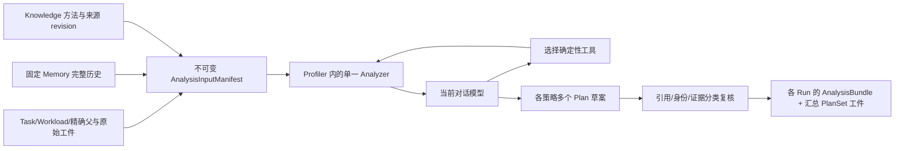

# Phase 2C Profiler / Analyzer 接口指南

2026-11-11。Analyzer 属于 `rsi_kernel_agent.profiler`，直接使用宿主对话模型推理。没有独立模型 API、自动 Kernel 执行或新的实验数据库。2A schema v1 和 2B 接口保持原样。

## 数据流与边界



模型读取完整输入、提出解释和变换；Python 负责数值、绑定、有限 JSON、原始工件核验和输出结构。源码/方法中的文字仅作为数据。工具不执行源码、shell、网络、TPU 或 Colab。没有用固定摘要模板充当推理；测试 replay 与实际会话模型样本分别记录。

## AnalysisRequest 与输入固定

`AnalysisRequest.from_dict(payload)` 严格校验字段；`.to_dict()` 返回独立副本。schema_version 必须是整数1。

| 字段 | 内容 |
|---|---|
| request_id/task_id/workload_id | 稳定 ID；任务与负载关系核验 |
| strategies[] | strategy_id、parent_id、context_id、snapshot_id、run_id（可 null）、source_artifact、config_artifact、profile_ids、benchmark_ids |
| knowledge[] | method_id、确定性 note_id、原始字节 revision |
| environment/tool_versions | 分析宿主环境与版本；实际实验环境取各 EvaluationContext |

source/config ArtifactRef 的摘要必须等于现有 ParentCandidate.identity；build_digest 仍只是构建配方声明。当前 Profile/Benchmark Run 必须测量这个 parent.candidate_id 且属于同策略、同 context。导入基线可以无 Run 并输出探索 Plan，不能借用其他候选的实测。所有当前记录须已经存在于各自 Memory snapshot。

```python
from rsi_kernel_agent.profiler.inputs import AnalysisRequest, capture_inputs, load_manifest

request = AnalysisRequest.from_dict(payload)
manifest = await capture_inputs(store, knowledge, request)
saved_ref = manifest.artifact_ref
replayed = load_manifest(store, saved_ref)  # 离线，不读取最新知识
```

capture 复用 MemoryReader，分别读取每个参与策略完整历史；递归核验 Evidence.input_ids，拒绝换 Run/候选/策略的当前测量。缺失原始 Profile 工件保留记录但标 unavailable；源码/配置缺失直接拒绝。failed/refuted 等证据不能成为可用当前测量。Benchmark 时长需匹配同 Run、supported/completed 的 measured_timing、trace_derived 或 derived_measurement（ms）、有效工件和成功/确认的评估；冲突值原样保留但 unavailable。

manifest 保存全部引用与摘要、source/config 文本和工件、完整历史、Knowledge 捕获、缺项与一致性声明。回读重新构建记录绑定、核验内容和全部可用工件，不仅相信 caller 给出的摘要。完整性仅覆盖已提交 Memory 快照；`knowledge_corpus_snapshot_consistent=false`，`combined_atomic_snapshot=false`。

Knowledge 使用原 fetch 的 expected_revision，再复用 MethodRecord 解析。文档内容以独立内容摘要归档；MCP 原始文件 revision（可能含 BOM）与解码正文摘要不同。来源变更保留旧 excerpt/revision，并标 stale；不能读取的旧全文不虚构。新分析才重新检查实时新旧状态。

## Profile 归一化与复用

实际外部入口为 `PallasKernels/tools/tpu_duration_profile.py::read_profile`，输入唯一 `.xplane.pb`，输出目标 program/custom-call 的 duration_ps 样本及统计。详见[解析器审计](../knowledge-site/manifests/phase2c-2026-11-11/parser-audit.md)。当前未安装 TensorFlow/protobuf 解析依赖，没有执行原始 protobuf 解码；复用的是保存输出 schema 和明确注入 reader 的适配接口。

`normalize_duration_report(report, *, binding, artifact_refs)` 重新计算样本统计并校验声明值；`normalize_events(events, *, binding, artifact_refs)` 支持显式提供的 program/operation/custom_call/dma/wait/synchronization 事件。每个事件有 device、clock、classification、start_ps、duration_ps、bytes、source_refs、reason、metadata。classification 区分 measured/trace_derived/compiler_estimated/inferred；缺失数值为 null 并附原因。

同设备同钟域可比较事件取区间并集；program 与嵌套 kernel 不直接求和，跨设备不声称统一 span。union 不是 end-to-end latency 或 critical path。遗留解析输出没有独立 DMA/wait/同步、compiler/resource、LLO 正文；capabilities 明确 unavailable。模型预测/来源主张工件不能经过 measured duration adapter 提升为测量。

归一化输出含 binding、原始工件引用、events、operation_stats、interval_unions、metadata、capabilities、quality、critical_path 和 multi_device_span。绑定仍是生产者声明，没有验证真实已加载代码。

## 四类数学模型

`calculate(model, inputs, *, evidence_refs=(), assumptions=())` 返回 schema/model revision、公式、输入/单位、假设、遗漏成本、输出/单位、引用和 unavailable。所有结果标 `model_predicted`。布尔、负尺寸、非有限值、未知字段拒绝。

| 模型与输入 | 公式和边界 |
|---|---|
| compute_memory：m,n,k,dtype_bytes；可选 compute_rate_flops_s/bandwidth_bytes_s/hardware_basis | F=2mnk；最低流量=(mk+kn+mn)d；I=F/bytes；资源下界 max(F/P,bytes/B)。未知率返回 null，不能猜硬件峰值 |
| tile：m,n,k,tile_m,tile_n,tile_k,dtype_bytes | ceil维度/块尺寸；统计padding、循环、tile流量及块内重用。假设每归约块重读，忽略跨输出tile缓存 |
| live_memory：buffers[{name,elements,dtype_bytes,copies,start,end}]；可选capacity_bytes/hardware_basis | 半开逻辑生存区间扫描，peak=max sum(elements×bytes×copies)。不把不同时间的buffer简单求和 |
| pipeline：stages,transfer_s,compute_s | serial=N(t+c)；ideal=t+c+(N−1)max(t,c)，含fill/drain。假设独立资源及足够buffer，不计同步/竞争 |

给定硬件率或容量必须提供 basis 及来源/假设。参数名固定单位；所有容量/时间估计都不能直接标成实测。实际例子的计算：131072 FLOP、20480最低byte、强度6.4 FLOP/byte；A tile16估计36864byte，B tile8估计69632byte，B8×16×8变体估计53248byte；A双buffer估计5120byte但容量未知；假设2µs搬运+3µs计算的四阶段理想时间14µs，**与合成10ms计时无因果或拟合关系**。

## 会话模型交互

`Analyzer(manifest, artifacts=store.artifacts, skills={name:text}, configuration='review', max_turns=6, max_tool_calls=12, max_response_chars=60000)`。

1. `packet()` 返回完整固定输入、指令、输出 schema、允许工具及剩余动作预算。
2. 当前对话模型返回 `{"tool_calls":[{"id":"...","name":"calculate","arguments":{...}}]}` 或 `{"final":proposal}`。
3. `advance(response)` 验证并执行 allowlist，返回 null（继续）或最终结果。无效响应不污染已接受 transcript；工具错误显式返回供模型调整。
4. `run(reasoner_callable)` 是同一流程的宿主桥接便捷接口；没有内置 LLM 服务或硬编码方案生成器。

工具：source、history、knowledge、reference、profile、calculate、skill。history 返回完整固定历史；knowledge 读取已固定结果。新的知识/官方文档检索由宿主先使用已有 KnowledgeClient/工具，明确取版本后建立新 manifest，不能静默加入未固定网页。现有 skill 文本/摘要存入结果以便复现；选择使用与否由模型决定。

`session.start_session(store, manifest, directory, model_label=...)` 创建 packet.json；宿主写 response.json 后调用 `submit_response(store,directory,response_path)`。每次重新验证 manifest 并重放已接受交互，输出下一包或 result.json。也可 `python -m rsi_kernel_agent.profiler.session --db ... --artifacts ... --session ... --response ...`。这是可信本地、单写入者的会话目录，不是分布式队列；崩溃时用 session.json 重放，单个结果文件不是完整备份。

## 输出、复核与兼容

proposal 含每策略 code_understanding（阶段、循环、搬运、依赖、布局/内存、同步、边界及引用）、observations、带 alternatives 的 hypotheses、plans、unknowns。至少每策略两份不同 mechanism 和 modification；Plan 显式 parent、变换、refs、observation_ids、calculation_ids、tradeoffs、risks、unknowns、variants、correctness/performance验证项。这是提案，不证明任意 Kernel 变换在语义上合法。

观察类别：observed_fact、derived_measurement、compiler_estimate、mathematical_prediction、source_claim、historical_claim、hypothesis、unknown。精确 predicate `{ref,path,value}` 可核对原值；path从reference.value开始，例如Benchmark为`["latency_ms"]`、Evidence数值为`["value"]`、计算结果为`["outputs","work_flops"]`，不要重复添加外层value。生成的事实文本由程序渲染。模型解释另存 proposed_explanation 并标 hypothesis，避免一个合法引用证明任意因果句。不能证明的断言降级为假设，保留合法探索。Knowledge/History 不提升为本地事实；预测值不提升为 measurement。

`publish_result(store, manifest, result, key)` 回读验证 manifest、完整重放模型选择和工具结果、比较全部结果，才写汇总工件。各真实 Run 各有现有 AnalysisBundle；无 Run 的基线不伪造 Bundle。Plan 使用现有 Plan 和 MemoryWriter.bind_plan；Task note Decision 记录版本化汇总与完成标记。没有 consider、parent selection、frontier 或 best 修改。

多记录发布不是一次数据库事务：确定性ID/幂等键允许同值重试，失败可留下前缀和未引用blob；消费者只使用最终完成Decision。不同结果重用键拒绝。任意低层store写入仍属可信调用方边界。

## 评估、限制与 2D 建议

[固定案例](../tests/fixtures/analyzer_cases.json)覆盖10个用户要求的陷阱；模型包去除expected。四组用同一继承会话模型、相同6响应/12工具/60000字符预算；每组一次批量10案例。真实模型响应和确定性回放分开，报告不以长度/自评分衡量质量。评分是引用、明确断言、单位、策略/父绑定、结构/变换描述差异、受控实验选择及工具复算的有限代理；不能自动证明任意自然语言或变换语义。

当前未暴露provider token统计或精确可固定的模型版本；相同会话配置不等于严格token对齐的科研实验。单样本不能证明skills/tools普遍提升。只将最终review配置满足验收视作本地功能验证。

2D建议：先读取完成标记和PlanSet，建立单机预算/队列状态机；同策略多Plan独立展开、保留失败/延期、有限repair并精确父链；重用2A晋升，运行端另行证明已加载源码和工件绑定。先以合成Runner验证中断/重复/超时恢复，最后才在Phase3授权范围集成真实MLA/Colab。**本阶段只提出建议，未实现Controller或执行端。**
