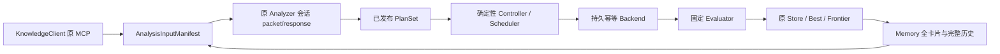

# Phase 2D+ Workflow / Controller

2026-11-11。仅限本地 synthetic 软件闭环；真实 MLA、Colab、TPU 与原始 XPlane 集成属于尚未开始的 Phase 3。

## 复用与架构

所有实验仍保存在原 ExperimentStore SQLite schema v1 和 ArtifactStore。2A/2B/2C 源码不改；没有第二数据库、Knowledge 服务、Benchmark 系统或模型 API。新的 workflow 状态和回执使用追加 Decision，原 Run 状态使用 transition，晋升只调用 consider。



Profiler 原多策略结果工件和每 Run 独立 AnalysisBundle 保留。Controller 不推理、不执行模型写指针指令。人或当前会话模型提交 Analyzer/repair 响应；测试与 demo 使用明确标注的 recorded synthetic response。

## 输入与接口

`workflow.intake.intake_publication(store, publication_id, round_id, variant_specs, knowledge=None)` 是异步入口。publication_id 必须是原 `publish_result` 完成标记。它重放 Analyzer exchanges、核对完整结果、Plan 和父绑定、每 Run AnalysisBundle、manifest 工件与实时 Knowledge note/source revision。每个 Plan 独立返回 accepted/rejected/waiting 与理由；全部结果在一个 Decision 中原子保存。原 publication 跨轮不能重复产生实验。相同输入返回原结果；等待结果是历史记录，不原地改写。

variant_specs 以 proposal_id 为键，数组顺序、个数与原 Plan.variants 相同，允许不同 Plan 有不同个数。每项字段：

```json
{
  "label": "必须等于原文字变体",
  "source_ref": {"digest": "SHA256", "size": 123},
  "config_ref": {"digest": "SHA256", "size": 12},
  "build_ref": {"digest": "SHA256", "size": 20},
  "scenario": "success", "latency_ms": 8,
  "priority": 0, "device": "synthetic:0",
  "cost": {"executions": 1, "tokens": 0, "time_s": 1}
}
```

源码/配置/构建工件必须存在且通过摘要核验。源码由会话/调用方明确提供；generation 指将已声明字节物化到隔离工作区。它不代表用 Controller 自动生成 Kernel，也不证明执行过该源码。每次源码变更新建 Candidate。Build identity 仍是声明配方身份。

scenario 支持 success、generation_failure、compile_failure、correctness_failure、execution_failure、timeout、invalid_measurement、deferred、incomplete、inconclusive。有效 synthetic latency 是有限正 ms；它只是 fixture 数值。deferred 在调度前阻止启动，显式 resume_job 后以原身份继续。

`workflow.rounds.prepare_round(store, knowledge, task_id, context_id, strategies, round_id, knowledge_refs, *, parents=None, parent_policy='branch_best')` 返回 manifest/request/snapshot/cards/histories。先固定原始快照，读取全部策略卡片和参与策略完整历史；branch_best 独立选择各路线最佳，或使用明确 current parent；explicit 策略要求所有父 ID。追加 ParentCandidate 和 select_parent 后再固定分析快照。重复 round_id 不重选后来更好的父；不同参数拒绝。下一轮不借用其他 Candidate 的 Profile。

## Controller 与预算

```python
from rsi_kernel_agent.workflow.controller import Controller
from rsi_kernel_agent.workflow.execution import SyntheticBackend

backend = SyntheticBackend(store, workspace_root)
controller = Controller(store, task_id, backend, limits={
    "max_concurrency": 2, "executions": 100, "tokens": 100000,
    "time_s": 10000, "max_repairs": 1, "max_retries": 1,
    "weights": {"A": 1, "B": 2}
})
controller.accept_intake(intake)
state = controller.run_until_idle(max_steps=1000)
```

同 Task 已创建的 limits 不可静默改变。`step()` 进展一个调度批次；`run_until_idle()` 有步数上限，等待/阻塞不冒充完成；`status()` 返回全部 jobs、成本预留、剩余预算、暂停策略及 workflow_state。`pause/resume(strategy,reason)` 影响新调度，已启动工作保留资源并完成查询。`resume_job(job_id,reason)` 显式重新排队延期工作。`cancel(reason)` 阻止新工作、保留已完成事实并对已有操作先查证。

调度按每策略 served / weight 选择路线，策略内优先较大 priority，再按稳定 ID 排序。默认权重相同，不硬编码 A:B 配额。并发限制包含运行、评估和结果不明的工作。同Task同设备的benchmark彼此独占直到可靠完成。当前generate/compile/correctness均为软件模拟，不阻止它们与benchmark交错；真实设备接入前必须增加跨Task设备仲裁、设备容量/许可和会影响计时的其他阶段隔离。更快的 A 不取消 B。

每次 admission 原子预留 executions/tokens/time_s 全部上界；execution 至少 1。失败不退款，重复接收/恢复不重复计费。tokens/time_s 为显式预算，不是实际模型计量或硬件用时。用完保留 deferred，原 Run 同步 not_run/deferred。预算覆盖执行尝试和修复变体携带的声明成本。Analyzer原会话动作预算独立；没有provider token计量、整体模型费用上限或wall-clock watchdog，timeout只是合成情景，产生修复响应前的会话消耗不在这些成本内。

## 生命周期与固定评估

queued → active(generate → compile → correctness → benchmark) → evaluating → completed / failed。未启动可 deferred/cancelled；未知外部结果 blocked。细分阶段通过 journal 留痕，不扩充 2A 状态枚举。Candidate、Run 和来源备注由确定性 ID 幂等创建，结果前缀可补齐。

Backend 协议为 `lookup(operation_id)`、`submit(request)`、`poll(operation_id)`；返回 definitely_not_started/running/completed/unknown 和 receipt。请求绑定 Task/Workload/Strategy/Plan/Candidate/精确父/Run/context、源码工件、契约摘要、设备与成本。固定契约包含完整 Task、Workload、EvaluationContext 记录和 evaluator policy。

SyntheticBackend 先持久化请求，完成后将 canonical 原始 receipt 工件与引用提交到原 Store，再返回。工作区以 Candidate ID 摘要隔离，拒绝链接/junction，复制原始字节；不使用能反向修改工件的可写硬链接。编译和正确性都是 synthetic 声明，未实际编译执行源码。

`integrate_result(store, job, receipts, cancelled=False)` 核验原始 receipt、持久发布、阶段顺序、精确身份、契约、正确性、有限 timing、同 Run Profile 和父计时来源，再追加 Evidence、EvaluationBundle、ProfileBundle、终态 RunEvent、consider 以及完成标记。结果包括 correct_faster/correct_slower/correct_inconclusive、generation_failed、compile_failed、incorrect、execution_failed、invalid_measurement、incomplete、cancelled。无可比父基线为 inconclusive；Store 仍独立应用原晋升资格。正确但计时不足的结果可进入 Last Correct，不成为 Best。

正确评估的候选按显式固定策略保留在 Frontier；Current Parent 只在 prepare_round 的确定性选择时更新。Latest Attempt、Last Correct、Branch Best、Task Best、Frontier、Paused、Deferred 保持原 Memory 各自语义。

## Repair 与恢复

`repair_packet(job_id)` 返回失败 Candidate/Run、父身份、固定契约与失败结果；当前会话模型补充 variant 和 reason 后通过 `submit_repair(job_id,response,key)` 提交。响应不能更改原绑定/契约。新 source 生成新的 repair Candidate，ParentCandidate 精确指向失败 Candidate，原 Plan 基点不变。每失败 Candidate 只能有一个修复后继，链深受 max_repairs 限制；无响应时保持失败，不自动无限推理。当前所有已归类失败均可显式提交修复；Controller不按错误类型自动选择修复方法，达到次数上限时拒绝并保留原失败，未自动将策略标paused。`retry(job_id,key)` 则只对execution_failed/incomplete允许原代码重试，同 Candidate 新 Run，受 max_retries 与剩余预算控制；compile_failed/incorrect不得以该接口重跑。

所有控制状态放在追加的 workflow_state.v1 Decision 中，revision/previous_id/state digest 核验连续。每次操作使用同主机每 Task OS 文件锁，进程死亡自动释放，不删除锁路径。Controller 并发调用冲突明确报错。它不是跨主机 fencing 协议。

恢复先重建 journal，补齐 Candidate/Run/控制投影，再 lookup 原 operation：completed 只归档；running 查询原操作；definitely_not_started 才提交原请求；unknown 保持 blocked。不通过换 operation ID 处理不确定结果。原 Run transition 的 expected_event_id 与请求键固定。集成开始时固定评估意图，后来取消不会改变已提交结果前缀。暂停先保存 journal 意图，再同步原 Memory 的 paused/resumed Decision，崩溃后可补写。

同一 Task 只允许此协议的单个活跃 Controller；低层调用方仍能绕过应用协议追加 Decision。这与2B应用层绑定边界一致。真实 backend 必须能权威查询和幂等提交远端操作；单靠本地 SQLite 无法保证远端实验恰好一次。

## CLI 与 Demo

仓库根 PowerShell：

```powershell
$env:PYTHONPATH = (Join-Path (Get-Location) 'src')
& '.\knowledge-site\.venv-mcp\Scripts\python.exe' -B -m rsi_kernel_agent.workflow --help
& '.\knowledge-site\.venv-mcp\Scripts\python.exe' -B -m rsi_kernel_agent.workflow demo --output '.artifacts/my-synthetic-demo'
```

demo 要求全新目录，调用原 MCP build_server 读取隔离 synthetic 知识笔记、原 session 工具响应与真实 Store API。结果在该目录 report.json，包含两轮、全部卡片/历史、publication/AnalysisBundle/PlanSet、Candidate/Run、评测、修复、Best、Frontier 和最终状态。不会生成 `.auth`。已有目录使用 run/recover，不重复创建 demo。

全局参数 `--db / --artifacts / --workspaces` 放在子命令前。命令包括 create、round、next-round、respond、intake、status、cards、queue、results、failures、run、recover、pause、resume、resume-job、cancel、repair-packet、repair、retry。具体 JSON 输入参考模块 schema 和 `--help`。round 接受原 AnalysisRequest 文件；respond 使用原2C response；next-round 按 branch_best 读取新快照并产生会话 packet。intake 使用原生产知识库只读实时来源检查，不自行改写知识。

## 验证和边界

完整命令、A–G 覆盖、实际子进程崩溃点、独立审查与最终统计见 [本阶段验收报告](../knowledge-site/manifests/phase2d-2026-11-11/implementation-report.md)。测试固定响应均为 recorded fixture，不是模型能力评估。

- 所有 latency、Profile、cost 与 correctness 是 synthetic；没有实际 TPU 性能收益证明。
- journal 每次保存完整 workflow state，Store/Memory 全量加载历史，成本随候选和事件增长；当前只验收小规模软件闭环，不具备大规模性能结论。
- 使用本地文件锁、SQLite 和工件目录；不声称分布式文件系统或断电持久性测试。
- 根目录、Store 和原始生产者是可信边界；不支持恶意本机修改数据库和文件。
- 来源实时检查与快照不是跨系统原子事务。后续来源变化不重写已归档计划和已发生实验；重分析需要新 publication。
- 真正 Phase 3 需落实可信 correctness oracle、受控计时、已加载 Kernel 身份、远端 operation 查询/去重及原始 Profile 证据，不可直接把 synthetic receipt 当真实执行端。
