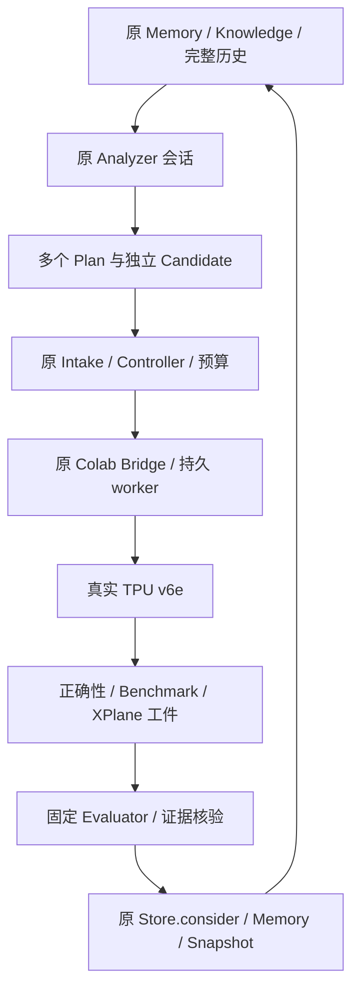

# Phase 3 / P3.5 真实硬件验证进展与交付报告

<!-- p35-runtime5-continuation -->
<!-- p35-runtime6-continuation-20261113T2301 -->
> **Runtime 5 归档与 Runtime 6 准入｜2026-11-13 23:01（Asia/Shanghai，进行中）**：Runtime 5 恢复第二轮四项已确认 **零 durable 远端请求/回执**，原 Journal / Evaluator 已完成归档：首项 cancelled / incomplete，其余三项保留 not_run；原 operation、源码、Context 和旧 13 个作业保留，Task 未取消、预算未退回。归档为 **revision 151、Snapshot version 14 / 986 records / high-watermark 1011**，预算仍为 **11/16 executions、19800/28800 声明秒**。独立只读核验通过，包含 1920 条关系闭包；此前 22:33 的“零提交待核验”记录保留为历史。
>
> Runtime 6 `tpu-v6e1-s-euw4a0-1q01sb2h5jte9` 已完成固定环境准备，同步 JAX 探针 **140.0**。四项新准入正在执行；本地 checkpoint 显示首项 attention 负例 generate 于 **23:00:20 completed**，compile 从 **23:00:49 running** 推进至 **23:01:40 completed**，尚无首项最终正确性结论或四项全部通过核验。**准入未完成，恢复候选和单 tile 硬件诊断未完成。**
>
> 后续先用现有预算执行 **2 个 A 恢复候选 + 2 个独立诊断 Run**，共 4 次 / 7200 秒；若无额外 repair / retry 预留，累计到 **15/16、27000/28800**，留 1 次 / 1800 秒。两项 B 候选仍属原四候选总目标；仅在新 A 取得真实 correct / valid / Profile 完整证据、两项诊断核验和 Memory/Best/Frontier/Current Parent/预算核对完成后，才准备 **2 executions / 3600 声明秒**的明确 grant 批次。**目前没有追加 grant，新 continuation 辅助尚未交付，不能将已有 grant 接口写成自动循环就绪；P3.5 仍未最终验收。**
>
> 证据：[R5 归档](../../.artifacts/phase3-2026-11-12/real-round-2-runtime5/runtime-loss-archive.json)、[归档独立核验](../../.artifacts/phase3-2026-11-12/runtime5-loss-independent-verification-20261113.json)、[R6 环境](../../knowledge-site/manifests/phase3-2026-11-12/environment-isolated-runtime6.json)、[同步探针](../../knowledge-site/manifests/phase3-2026-11-12/isolated-probe-runtime6.json)、[原准入 checkpoint](../../.artifacts/phase3-2026-11-12/runtime6-progress.jsonl)、[Runtime 6 继续计划](phase3-p35-runtime6-continuation-plan.md)。以下 22:33 及更早记录完整保留；本次更新没有另行推送 GitHub。
<!-- /p35-runtime6-continuation-20261113T2301 -->
> **Runtime 5 中断与继续申请｜2026-11-13 22:33（Asia/Shanghai，进行中）**：恢复第二轮首项 `length-row` 于 **22:23:39** 在 `generate` 阶段进入 **blocked / unknown**，原驱动随后退出，exit 0；其余三项仍 queued/generate。当前保存的 Controller 为 **revision 150**，四项均无已回收阶段回执或最终结果。**22:26:52** 查询原 operation 的桥接结果为 `Exit`（returncode 1），**22:26:53** 原控制面观察为 `assignments=[]`。这不证明原请求未启动；durable 远端提交是否为零仍在独立核验，本次不宣称零提交或第二轮硬件完成。此前四项重新准入的真实结果保留在原 Context。
>
> 原预算已预留首项，现为 **11/16 executions、19800/28800 声明秒**，剩余 **5 次 / 9000 秒**。若仍需完整的 **4 个恢复候选 + 2 个诊断 Run**，需要 6 次 / 10800 秒，存在 **1 次 / 1800 秒**缺口；**尚未处理该缺口，未追加 grant、未退回预算**。不得把未知 operation 另建身份重派，或将本地无回执等同未执行。
>
> 原唯一连续申请于 **22:28:26** 启动（PID **39016**）；日志于 **22:28:32** 返回 `allocated`，新 Runtime 为 `tpu-v6e1-s-euw4a0-1q01sb2h5jte9`。本次本地检查已未见该申请进程，但未独立采集其退出码；新分配不等于环境、同步探针或重新准入通过。本次文档更新没有访问新 Runtime，后续继续沿原分配与准入流程核验。
>
> 证据：[本地 checkpoint](../../knowledge-site/manifests/phase3-2026-11-12/runtime5-recovery-checkpoint-20261113T143320350Z.json)、[原 Controller 状态](../../.artifacts/phase3-2026-11-12/real-round-2-runtime5/controller-status.json)、[原 operation 查询](../../.artifacts/phase3-2026-11-12/real-round-2-runtime5/bridge-inspection-20261113T142652450503Z.json)、[申请启动及控制面观察](../../.artifacts/phase3-2026-11-12/p35-continuation-launch-20261113T142826457Z.json)、[分配日志](../../.artifacts/phase3-2026-11-12/p35-allocation-continuing-20261113T142826457Z.txt)。以下 **22:17、21:04 与 19:07 / 19:19** 记录保留为历史；P3.5 仍未最终验收。
>
> **恢复第二轮更新｜2026-11-13 22:17（Asia/Shanghai，进行中）**：Runtime 5 原四项重新准入已完成；原驱动于 **21:30:58** 正常结束，exit 0。**21:33:22** 的只读核验为 **4 verified、0 pending、0 failed**，核验 **131 个去重工件、515,870,575 bytes**；两个错误负例被固定 Oracle 拒绝，A 修复基线与 B delayed-store-wait 均取得当前 Context 的真实结果。
>
> 恢复第二轮已读取 **Snapshot version 13 / 944 records / high-watermark 969**。原 Analyzer 保存 **3 次 response、18 次工具调用（11 次读取 + 7 次数学计算）**，四个 Plan 的结构审核 `review=[]`、`winner_selected=false`，四项候选源码已打包。原恢复驱动已于 **22:12 启动，启动后观察为前置校验**；本次更新尚未观察到其硬件执行阶段，不能将驱动启动、分析完成或源码打包计为第二轮硬件完成。独立 single-tile 诊断及最终 Memory/Best/Frontier 核验仍待真实完成，P3.5 保持进行中。
>
> 派发前原探索预算仍为 **10/16 executions、18000/28800 声明秒**，后续扣费以原 Journal 为准。累计预算 grant 已实现，但**尚未实际追加预算**。根级完整回归于 **22:14:30** 结束：**342 项、339 通过、3 跳过，471.090 秒，exit 0**。该次套件启动时预算专项含 21 项；之后旧 grant 的精确比较调整及新增第 22 项，由最终 **31 项 focused** 与独立 **22 项**专项验证，均通过，未宣称最终源码又完整重跑 343 项。下方 **321 项、609.492 秒、exit 0** 保留为核心预算修改前的历史记录。
>
> 证据：[四项准入核验](../../knowledge-site/manifests/phase3-2026-11-12/runtime5-prerequisite-verification.json)、[准入驱动退出码](../../.artifacts/phase3-2026-11-12/runtime5-prerequisite-execution-20261113-result.json)、[新 Snapshot 与准备输入](../../.artifacts/phase3-2026-11-12/real-round-2-runtime5/prepared.json)、[Analyzer 结果](../../.artifacts/phase3-2026-11-12/real-round-2-runtime5/result.json)、[四项源码索引](../../.artifacts/phase3-2026-11-12/real-round-2-runtime5/candidate-artifacts.json)、[根回归日志](../../.artifacts/phase3-2026-11-12/p35-root-tests-budget-20261113.txt)、[退出码](../../.artifacts/phase3-2026-11-12/p35-root-tests-budget-20261113-result.json)、[最终 31 项专项](../../.artifacts/phase3-2026-11-12/p35-budget-final-focused-tests-20261113.txt)、[独立 22 项专项](../../.artifacts/phase3-2026-11-12/p35-budget-independent-final-tests-20261113.txt)。以下 **21:04** 记录及 **19:07 / 19:19** 正文保留为历史时点；本次继续执行改动尚未另行推送 GitHub。
>
> **继续执行更新｜2026-11-13 21:04（Asia/Shanghai，进行中）**：本次先查询原 correctness operation，未取回最终回执；控制面确认 Runtime 4 已不在分配列表。已将其 attention 准入按 **unknown / incomplete** 归档，保留三项原请求与 generate/compile 两份成功回执，无新正确性结论或 Evaluation，其余三项保持 not_run。21:02 的独立只读核验确认原 Controller revision 146、预算 **10/16 executions、18000/28800 声明秒** 完全不变。
>
> 原持续申请循环于 **20:53:28** 取得 Runtime 5 `tpu-v6e1-s-euw4a0-2u7r1pvl8i4i8` 后正常结束。固定隔离环境 ready、单 TPU v6 lite／单进程，同步探针 **140.0**。四项新准入 Run 已创建，worker bootstrap ready，原准入驱动已启动；**尚未宣布准入通过、恢复第二轮或单 tile 诊断完成**。本次根级回归 **321 项：318 通过、3 跳过，609.492 秒，exit 0**。恢复辅助已扩展 Runtime 5，软件核验不替代硬件结果。后续按用户最新授权继续迭代，无设备时沿原流程持续申请。
>
> 证据：[未知结果归档](../../.artifacts/phase3-2026-11-12/runtime4-prerequisite-loss-archive.json)、[归档只读复核](../../.artifacts/phase3-2026-11-12/p35-runtime4-unknown-loss-readonly-verification-20261113T130242860325Z.json)、[新环境](../../knowledge-site/manifests/phase3-2026-11-12/environment-isolated-runtime5.json)、[同步探针](../../knowledge-site/manifests/phase3-2026-11-12/isolated-probe-runtime5.json)、[根测试退出码](../../knowledge-site/manifests/phase3-2026-11-12/p35-root-tests-runtime5-20261113-result.json)、[继续计划](phase3-p35-runtime5-continuation-plan.md)。以下正文保留 19:07 / 19:19 时点的历史报告；这些继续执行改动尚未另行推送 GitHub。
<!-- /p35-runtime5-continuation -->

**2026-11-13｜第一轮真实优化与 ABBA 独立复测已完成；第二轮方案和源码已准备，真实执行尚未完成。P3.5 保持“进行中、未完成最终验收”。**

本报告按此前阶段报告的结构，汇总已确认成果、交付文件、测试、GitHub 上传与继续条件。运行状态采用 **19:07（Asia/Shanghai）** 的只读核验；GitHub 上传采用 **19:19** 的远端哈希核验。本文整理期间没有重新申请 TPU、执行 Kernel 或查询远端最终运行状态。

原始目标见 [P3.5 请求](../../knowledge-site/manifests/phase3-2026-11-12/sources/p35-request.txt)。较早时间的逐次记录保留在[总报告](../../knowledge-site/manifests/phase3-2026-11-12/implementation-report.md)与[验证记录](phase3-p35-final-validation.md)中；本文不将历史时点的状态混作当前事实。

## 一、阶段与验收结论

| 项目 | 已确认状态 | 尚未完成或结论边界 |
| --- | --- | --- |
| P3.0–P3.3 | 完成既定范围的审计、历史恢复、真实接入、可信基线和 Profile 链路 | 历史设备成功不代表当前在线；独立 DMA/VMEM/MXU 指标仍不可用 |
| P3.4 第一轮 | 4 Plan / 5 Candidate 完成真实执行，三组正确性通过，结果写回原 Store | 单次更快不等于稳定收益 |
| Runtime 3 重新准入 | 五项完成并独立核验，包括两个错误负例、A 基线、B 候选和独立 B control | 该 Runtime 后来消失，旧结果保持原 Context |
| ABBA 独立复测 | 四个真实 Run 完成，完整样本与确认结论已归档 | program 有有限复测收益；host 漂移，联合结论 inconclusive |
| 第二轮 Analyzer | 从新 Snapshot 读取历史，生成四个新 Plan 及独立候选源码 | Runtime 3 消失前四项均未远端提交，不能计作第二轮硬件完成 |
| Runtime 4 | 已取得，固定版本隔离环境 ready，同步 JAX 探针返回 140.0 | 四项重新准入未完成；本地驱动已停止，需恢复原 operation |
| 恢复优化轮 | 新 Runtime / Context 隔离、归档检查与执行辅助已实现并测试 | Runtime 4 恢复轮尚未创建或执行 |
| 单 tile 零长度诊断 | 独立 workload、两角色源码、派发与核验辅助已准备 | 尚无真实硬件诊断结果 |
| P3.5 最终验收 | **未完成** | 至少一个新第二轮候选的真实验证、诊断及最终 Memory/Best/Frontier 核验仍待完成 |

本轮范围始终为 **MLA Decode contiguous BF16**。正式 Benchmark/Profile 仅覆盖 `decode-small`；MLA Forward、paged、其他 dtype 与更广配置不在本轮已验收范围内。

## 二、实际链路与交付



继续使用唯一 ExperimentStore/ArtifactStore、原 schema v1、Memory、Knowledge MCP、Profiler/Analyzer、Controller 和晋升规则。当前会话提供分析和明确响应，没有新增独立模型 API 或 Key。本次 Runtime 迁移兼容工作位于辅助脚本，没有重写核心 Controller 或另建实验数据库。

| 交付 | 文件与职责 |
| --- | --- |
| 受控复测统计 | [p35_confirmation_statistics.py](../../.artifacts/phase3-2026-11-12/p35_confirmation_statistics.py)：按冻结政策计算各维度结论 |
| ABBA 归档与第二轮前置检查 | [p35_publish_confirmation.py](../../.artifacts/phase3-2026-11-12/p35_publish_confirmation.py)、[p35_round2_gate.py](../../.artifacts/phase3-2026-11-12/p35_round2_gate.py)：绑定原回执、确认报告及新历史 |
| 未提交作业归档 | [p35_archive_unsubmitted_runtime_loss.py](../../.artifacts/phase3-2026-11-12/p35_archive_unsubmitted_runtime_loss.py)：固定旧身份、零远端提交检查、原锁与幂等归档 |
| Runtime 4 准入 | [admit_runtime4.py](../../.artifacts/phase3-2026-11-12/admit_runtime4.py)、[advance_runtime4.py](../../.artifacts/phase3-2026-11-12/advance_runtime4.py)：复用原 remeasure、Backend 和 Evaluator |
| Runtime 4 核验 | [verify_runtime4_prerequisites.py](../../.artifacts/phase3-2026-11-12/verify_runtime4_prerequisites.py)：只读复用原回执与 NPZ 核验器 |
| 恢复优化轮 | [p35_recovery_round.py](../../.artifacts/phase3-2026-11-12/p35_recovery_round.py)、[准备入口](../../.artifacts/phase3-2026-11-12/p35_prepare_recovery_round.py)、[执行入口](../../.artifacts/phase3-2026-11-12/p35_run_recovery_round.py)：隔离新轮身份，旧 ABBA 仅作为历史 |
| 单 tile 诊断 | [固定诊断契约](../../.artifacts/phase3-2026-11-12/p35_single_tile_diagnostic.py)、[准备](../../.artifacts/phase3-2026-11-12/p35_prepare_diagnostic_round.py)、[派发](../../.artifacts/phase3-2026-11-12/p35_run_diagnostic_round.py)、[核验](../../.artifacts/phase3-2026-11-12/verify_p35_diagnostic.py)：兼容旧选择，新增独立 Runtime 4 选择路径 |

工具实现和本地 fixture 通过仅证明准备与软件行为，不计作新硬件实验成功。

## 三、ABBA 独立性能复测

在同一 Runtime 3、同一冻结协议下，实际顺序为 **C–T–T–C**：C 为原修复基线，T 为 `delayed-store-wait`。每个角色有两个独立 Run；每个 Run 保存 20 个 host 样本及独立 Profile 的原始样本，不剔除异常点。

| 顺序 | host median（ms） | program median（μs） | prepare median（μs） | attention median（μs） |
| --- | ---: | ---: | ---: | ---: |
| C1 | 0.222100 | 6.610000 | 0.693750 | 5.043750 |
| T1 | 0.223945 | 6.180625 | 0.696250 | 4.643125 |
| T2 | 0.271240 | 6.225625 | 0.695625 | 4.633125 |
| C2 | 0.242520 | 6.617500 | 0.693750 | 5.065000 |

四项均完成真实五阶段执行、通过原三组正确性，timing valid、confirmed=true。这里的 confirmed 表示该 Run 满足固定证据契约，不代表已证明普遍稳定加速。

| 维度 | 实际结论 | 证据 |
| --- | --- | --- |
| host public-call latency | `inconclusive_drift` | 两对 reduction 为 −0.8307% / −11.8423%；control/treatment 角色 spread 为 8.7900% / 19.1020% |
| program duration | `replicated_observed_improvement` | 两对 median 降低 6.49584% / 5.92180%，通过冻结 program 判据 |
| 联合结论 | **`inconclusive`** | host 漂移，不能宣称稳定端到端收益 |

`p35-abba-v1` 预先要求两对 reduction 均至少 2%、全部 treatment medians 低于全部 control medians、各角色内部 spread 不超过 5%。每角色仅两个独立 Run，Run 内样本不能扩称独立实验数量。program/prepare/attention 来自真实 trace 与原 parser；本轮没有独立 DMA 时长、资源利用率或因果机制测量。

原 Evaluator 将四项相对所选父版本归为 `correct_slower`；这与 ABBA 的角色配对统计属于不同契约。确认报告已写回原 Memory，未直接改写旧 Best。详见 [ABBA 专项报告](phase3-p35-abba-results.md)。

## 四、第二轮分析、源码与中断归档

原第二轮 `real-runtime2-round:2` 实际绑定 Runtime 3，输入 Snapshot 为 **version 10 / 776 records / high-watermark 801**。Analyzer 读取全部 3 条状态卡、A 路线完整历史 268 条、B 路线完整历史 501 条，并读取源码、Profile 与 Knowledge；原会话记录 3 次响应、18 次工具调用，包含 7 项逻辑 payload 计算，`winner_selected=false`。

第二轮利用第一轮和 ABBA 改变探索方向：较小 tile 已出现 program 回退，故保留原 tile；single-tile recurrence 尚缺独立零长度覆盖，暂不纳入新优化；compact-new-row 没有明确整体收益，不简单重复；B 路线保留 delayed wait，分别探索 query 放置和 B=1 准备融合。

| Plan / Candidate | 精确父路线 | 实际源码变化 | 硬件状态 |
| --- | --- | --- | --- |
| R2-A-length-row | A 修复基线 | lengths 中间表示由 `[B,H,T]` 缩为 `[B,1,T]`，在 attention 内广播 | 未提交 |
| R2-A-length-smem | A 修复基线 | 去除 prepare 的 lengths 中间输出，attention 从原始 `[B]` SMEM 长度读取并广播 | 未提交 |
| R2-B-query | B delayed-store-wait | 将 query padding 从 prepare 移到 attention，保留其他必要准备与完整 cache 输出 | 未提交 |
| R2-B-b1-fusion | B delayed-store-wait | 静态 `batch==1` 时融合必要准备；B>1 保留父路径 | 未提交 |

候选有独立源码、diff、source/config/build 身份与明确父关系，未修改 Oracle、容差或 Benchmark。配置与完整输出契约保持不变。源码与身份见[候选索引](../../.artifacts/phase3-2026-11-12/real-round-2/candidate-artifacts.json)。

Runtime 3 消失后，原 Store 检查确认四项均没有 durable Colab request 或执行回执；首项只有本地预留、启动事件与 operation intent。归档在原 Journal 锁内完成：首项由原 `integrate_result(cancelled=True)` 记录 **cancelled / incomplete**，其余三项 Run 保持 **not_run**。不伪造阶段回执，不把未执行记成 Kernel 失败，不取消整个 Task，不退回首项已预留的 1 execution / 1800 声明秒。

归档 Snapshot 为 **version 11 / 818 records / high-watermark 843**。旧 Context、完整 operation intent 和候选保留；该 Snapshot 是中断归档证据，不是第二轮执行完成证据。详见[归档记录](../../.artifacts/phase3-2026-11-12/real-round-2/runtime-loss-archive.json)。

## 五、Runtime 4 与准确停止点

原分配流程于 **18:28:57** 确认取得 `tpu-v6e1-s-euw4a0-1xqzeyr91qwmg`，申请循环正常退出。固定隔离环境实测为 Python 3.11.17、JAX/jaxlib 0.8.1、libtpu 0.0.30、TensorFlow 2.20.0、xprof 2.22.1，单 TPU v6 lite／单进程；同步 JAX 探针返回 **140.0**，parser 可导入。

| 重新准入项 | 截至 19:07 的本地证据 |
| --- | --- |
| attention 错误负例 | generate、compile 成功回执已归档；correctness 请求已持久化，最终回执尚未回收 |
| cache 错误负例 | 新 Run 已创建，not_run |
| A 修复基线 | 新 Run 已创建，not_run |
| B delayed-store-wait | 新 Run 已创建，not_run |

本地准入驱动于 **18:53:28** 退出，exit −1；19:05:41 的进程查询没有发现原驱动或诊断包装驱动。原远端 worker 没有被停止。最后保存的 correctness 观察是 **18:53:03 running**，但上传前核验没有再次查询远端最终状态：**不能据此声称它现在仍运行，也不能因本地缺回执就断言远端未完成。**

Runtime 4 四项 Gate 尚未通过，active binding 文件仍为历史 `runtime3`。新恢复优化轮尚未创建，单 tile 硬件诊断尚未执行。继续时必须先按原 operation 查询、回收结果，再按原协议推进。见[环境](../../knowledge-site/manifests/phase3-2026-11-12/environment-isolated-runtime4.json)、[同步探针](../../knowledge-site/manifests/phase3-2026-11-12/isolated-probe-runtime4.json)、[上传前只读核验](../../knowledge-site/manifests/phase3-2026-11-12/p35-upload-progress-facts.json)。

## 六、Store、Snapshot 与预算

| 指标 | 已核验值 | 含义 |
| --- | --- | --- |
| 当前任务 Store | 835 records / high-watermark 860 | 19:07 只读事务看到的任务历史 |
| 最新已保存 Snapshot | version 11 / 818 records / high-watermark 843 | Runtime 3 中断归档时点，未包含之后的全部 Runtime 4 记录 |
| Controller | revision 146，13 jobs，Task 未取消 | 5 项第一轮、4 项 ABBA、4 项已归档旧第二轮作业 |
| 已用探索预算 | 10 executions / 18000 声明秒 | 5 次第一轮、4 次 ABBA、1 次中断前预留 |
| 总限额 | 16 executions / 28800 声明秒 | 换 Runtime 没有重置 |
| 剩余探索预算 | **6 executions / 10800 声明秒** | 可容纳四个恢复优化 Run 与两个独立诊断 Run，无额外 repair 余量 |

重新准入沿用独立 prerequisite reservation 记账，不混入上述探索预算。声明秒不是实际 TPU 账单或 wall-clock；0 reserved tokens 也不意味着模型推理没有成本。

已归档旧 Best 按其原 Context 保留。Runtime 4 父计时必须在新环境重新测量；后续 Branch Best、Task Best、Frontier 与 Current Parent 只能在相应 Context 内核验，最终核验目前尚未完成。

## 七、测试与独立审查

最新根级完整测试于 **18:54:58** 结束：

```text
Ran 321 tests in 423.235s
OK (skipped=3)
```

即 **318 通过、3 跳过、0 失败/错误，exit 0**。命令：

```powershell
& '.\knowledge-site\.venv-mcp\Scripts\python.exe' -B -X utf8 -m unittest discover -s tests -v
```

| 本地验证 | 实际结果 |
| --- | --- |
| Runtime 4 相关辅助回归 | 26/26 通过，11.289 秒 |
| 未提交作业归档 | 完整 fixture 10/10 通过，65.398 秒；观测变更专项另 4/4 通过 |
| 原真实轮次恢复兼容 | 11/11 通过，52.204 秒 |
| 恢复轮身份检查 | 5/5 通过 |
| 单 tile 诊断 v1/v2、verifier、固定契约与恢复检查 | 47/47 通过，141.357 秒 |
| 独立恢复/归档审查 | 另跑 15 项、观测 3 项、Runtime 4 准入/核验 13 项，均 exit 0 |
| 独立诊断 v2 审查 | 39/39 通过，147.742 秒，exit 0 |

各专项存在重复覆盖，不将它们相加为唯一测试总数，也不计入真实 TPU 验收。三项根测试跳过分别为两个 Windows symlink 权限用例和一个 Debian 专属 startup 用例，没有放宽权限。

独立 reviewer 在实际审查范围内没有报告未关闭的 Critical/Important。该结论不等于证明所有问题不存在。证据见[根日志](../../knowledge-site/manifests/phase3-2026-11-12/p35-root-tests-runtime4-20261113.txt)、[退出码](../../knowledge-site/manifests/phase3-2026-11-12/p35-root-tests-runtime4-20261113-result.json)、[恢复审查](../../.artifacts/phase3-2026-11-12/p35-runtime4-recovery-independent-review-20261113.md)、[诊断审查](../../.artifacts/phase3-2026-11-12/p35-diagnostic-v2-independent-review-20261113.md)。

保留证据范围：ABBA 发布器重算了原始 NPZ；独立 reviewer 核对身份、回执、保存 parser 与统计，没有重新解码全部 XPlane protobuf。设备执行时 input cache 不变沿用原 runner 检查，没有新增独立设备复证；LSE 不由当前接口暴露，单 tile 诊断也不宣称覆盖 LSE。

## 八、GitHub 交付

代码、测试、知识库程序、明确选定的 P3.5 辅助脚本、候选源码/diff 和当时的报告已上传：

- 仓库：[ZicongHe2002/rsi-kernel-agent](https://github.com/ZicongHe2002/rsi-kernel-agent)
- 分支：`main`
- 提交：[76f27a41c48a3a8b4756860d16c25773f25ea45f](https://github.com/ZicongHe2002/rsi-kernel-agent/commit/76f27a41c48a3a8b4756860d16c25773f25ea45f)
- 提交标题：`Add RSI workflow implementation and Phase 3 validation progress`
- 19:19 已核对远端 `main` 与本地该提交哈希一致。

本机既有 Git 2.54.0 已可通过绝对路径使用，没有新安装 Git。此次上传没有包含认证状态、个人笔记、运行数据库、下载环境与大型原始 NPZ/XPlane 工件。报告中的部分原始工件链接仅在原工作区可用；GitHub 源码上传不等于完整实验数据迁移。

**本文件是在上述提交后独立整理的进展报告，不属于 `76f27a4` 中的文件。**

## 九、继续执行顺序

1. 只读确认 Runtime 4 是否仍在线，查询 attention 负例的原 correctness operation。completed 只回收原结果，running 继续查询，unknown 保持核查；仅 definitely_not_started 才按原请求提交。
2. 继续原四项重新准入，核对错误负例、父版本、真实环境及完整原始证据；全部通过后才能切换 active binding。
3. 在新 Runtime 4 Context 下准备 `real-runtime4-recovery-round:2`，读取包含中断归档和新准入的新 Snapshot。旧 ABBA 仅作历史知识，不作为新环境性能分母。
4. 通过原 Analyzer、Intake、Controller 执行恢复优化候选，保留成功、失败、更慢及非晋升结果。任何新修复都需先检查原剩余预算。
5. 创建独立单 tile 零长度诊断：baseline 与原 single-tile 源码各一个 Run；覆盖合法长度、全无效 attention、完整 cache 与 opaque NaN 契约，不改旧 workload。
6. 回收并核验 NPZ、样本、回执、Profile 绑定，更新原 Memory；逐 Context 核对 Best/Frontier、Latest Attempt、Last Correct、Current Parent 和预算，再判断最终 Gate。

**当前交付结论：已完成真实首轮及可信 ABBA 复测，并保存了中断、恢复准备和失败边界；真实第二轮闭环与单 tile 硬件诊断尚未完成。当前既不宣布 P3.5 最终验收，也不宣布稳定端到端性能提升。**
