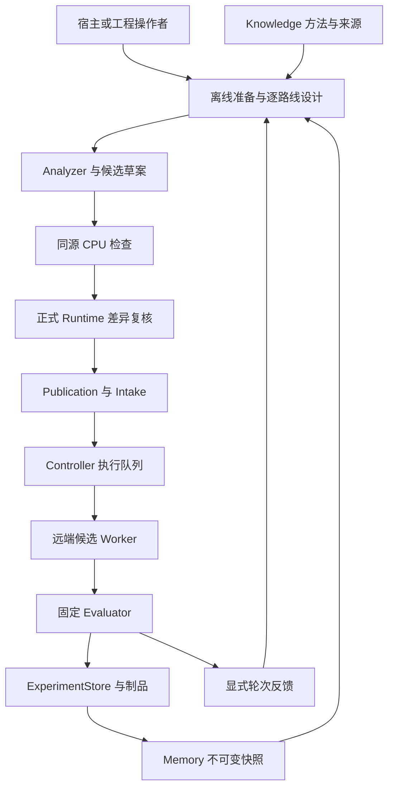
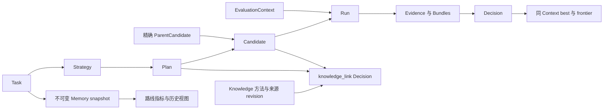

# RSI Kernel Agent：系统架构与组织调度（同事详解版）

更新日期：2026-11-23。
读者：需要理解、接手或协作开发该项目的工程同事。
本文以当前代码为主描述实现与已确认边界；示例候选只用于解释流程。正文包含理解系统所需的背景，图示同时配有文字说明，可单独转发此 Markdown。

## 1. 项目要解决什么问题

RSI Kernel Agent 用于组织可追溯的 Kernel 优化实验。
它把研究判断、候选实现、设备执行、固定评估和历史记录连接起来。
当前真实执行链路围绕 MLA Decode 的 contiguous BF16 接口建立。
它仍是研究原型：核心机制已经实现，端到端入口与新旧绑定仍有集成缺口。

一次优化不能只留下“改了几行，似乎更快”的结论。
需要知道改动基于哪份源码、使用哪些参数、在哪个环境运行，以及比较口径是否相同。
正确性失败、编译失败、被暂缓的候选，也需要成为下一轮能够使用的历史。

项目因此分开保存三类信息：

- 方法知识：机制是什么、适用条件是什么、来源在哪里。
- 实验事实：哪份候选实际运行过，产生了哪些测量与原始制品。
- 研究决策：为何选择某个父候选、提出某项修改、继续或停止一条路线。

代码不会因为方法来自官方文档，就认定它在当前 Kernel 上有效。
也不会因为某候选通过 CPU 检查，就认定它已经通过 TPU 编译或性能验证。

### 1.1 必须先区分的术语

| 术语 | 在本项目中的含义 |
|---|---|
| Task | 一个优化任务，带稳定身份与契约版本。 |
| Workload | 输入形状、数据类型、输出语义及测试案例等工作量规格。 |
| EvaluationContext | 一个可比较环境，绑定 Workload、环境、协议与来源类别。 |
| Strategy | 一条持续研究的优化路线，能够跨多轮保留历史。 |
| Plan | 某条路线中的具体修改计划。 |
| ParentCandidate | 对精确父实现的引用，包含源码、配置、构建身份。 |
| Candidate | 某个 Plan 的具体实现，必须绑定自己的父候选。 |
| Run | 一个 Candidate 在一个 Context 下的一次执行尝试。 |
| Evidence | 带来源类型、可用性、结论状态和制品引用的证据。 |
| EvaluationBundle | 固定评估得到的正确性、计时有效性和延迟结论。 |
| ProfileBundle | 与某次 Run 绑定的性能剖析证据集合。 |
| Decision | 追加保存的选择、关联、晋升和控制记录。 |
| Memory snapshot | 某个 Task 的不可变实验记录及投影快照。 |
| Knowledge | 保存在 Markdown 中的方法及来源知识。 |
| Publication | 模型分析结果通过校验后形成的持久化发布记录。 |
| Intake | 把已发布计划与实际候选制品核对并转为执行任务的入口。 |

Strategy 不是一个固定的模型进程。
当前任务中的 A、B、D 是 Strategy 标识，不是硬编码的四个 Agent。
Analyzer、Generator、Evaluator、Controller 是职责划分，也不要求各占一个模型。
Method 是可复用的优化机制，Strategy 是当前任务中围绕假设持续推进的路线；一个方法可用于多条路线，一条路线也可以组合多个方法。
这里的迭代更新的是 Kernel 实现及研究判断，不是训练模型权重。

### 1.2 系统边界

纯文本阅读：宿主组织研究输入，模型产出受约束的分析与实现；通过本地检查和正式绑定后，候选进入执行队列。
Worker 执行设备阶段，固定 Evaluator 接收可核验结果，Store 保存事实，下一轮再读取新的快照和反馈。
这张图表达完整闭环需要哪些环节，不表示 Controller 会自行发起图中的全部步骤。

## 2. 六步完成一轮优化

### 第一步：固定任务与父实现，冻结共同进展

先明确优化什么，以及必须保持什么。
输入形状、dtype、接口、输出、容差、计时边界和软件环境都属于比较条件。
当前真实 runner 的目标接口是 MLA Decode contiguous BF16。
不能把另一接口的历史数字直接写入当前排名。

源码、依赖文件、配置和可信运行工具按内容摘要固定。
CandidateIdentity 中的 source/config/build 摘要用于区分实现身份。
同一个短名称或文件路径相同，不足以证明加载的是同一实现。

正式执行还需要明确 Runtime session 和协议身份。
更换 Runtime、runner 或重要协议后，不能沿用旧绑定假装没有变化。
历史 Context 可以提供准备依据，但不自动成为新 Context 的实测父候选。

原始 baseline 导入有独立入口。
它用于把原始实现、执行契约和基线候选建立起来。
优化候选的 publication/intake 与这个 baseline 入口有不同的检查边界。
不能因为 baseline 走过独立入口，就省略优化候选要求的同源 CPU 检查。

父实现选择要显式记录。
“最近一次尝试”“最后一个正确候选”“本路线 best”“全任务 best”和“当前父候选”是不同字段。
如果需要切换父实现，应形成明确 ParentCandidate 和选择记录。

同轮先冻结一个 Memory snapshot，整理所有路线的共享进展与各自完整结构化指标历史。
这一阶段的结果是：任务可定义、父实现身份可固定、共同输入可追溯。
此时可以基于历史环境研究，不需要等待 TPU；当前 Runtime 的精确父版本测量在第四步补齐。

### 第二步：各路线独立研究，读取指标与按需详细证据

离线准备允许把大量研究与实现工作放在占用设备之前。
准备输入以一个冻结的 Memory snapshot 为依据。
同一批设计中的各路线共用该 snapshot，避免路线看到不同时间点的实验事实。
每条路线又有自己的 manifest，记录其父实现、相关知识和证据引用。
宿主按顺序为各路线组织独立 AI 分析上下文；前一路线关闭后再打开下一条。
这种独立性是研究输入和会话隔离，不是申请另一台 TPU，也不是重启 Notebook kernel。
显式引用的跨路线事实可以共享，另一条路线的完整对话不会自动成为当前路线的分析。

当前 route_progress 路径提供两层信息：

- 所有路线的最新进度：最近轮次、最新结果、best、状态及决策摘要。
- 当前路线的完整结构化指标历史：全部轮次和候选，连同失败、缺失与未执行情况。

“完整”指声明范围内的结构化指标覆盖。
它不表示模型每次重读所有其他路线的原始全文、源码包和 trace。
其他路线结果作为共享上下文；本路线的完整指标用于判断趋势与反例。
原始证据、历史源码和详细分析通过引用按需打开。

Knowledge 补充可复用机制、适用条件、风险和来源引文。
读取方法时固定方法笔记 revision，检查来源是否可用或已经变化。
知识来源中的历史收益不自动升级为当前任务的性能证据。

Analyzer 在这些输入上解释当前瓶颈、已有尝试与证据限制。
它需要说明拟议改动解决什么问题，并把事实与假说分开。
相同机制的参数调整可以继续归入已有 Strategy。
是否提出新的结构性路线，需要单独的机制比较与关联记录。

每条路线可以给出 Plan，也可以明确 no-plan。
例如机制已经实现、条件不具备、证据不足或收益假说被反例削弱。
有理由的暂停或关闭是有效研究结果，不必为了填满轮次而制造候选。

### 第三步：生成实际草案，执行同源 CPU 检查

Plan 必须落到实际源码与配置制品。
仅有自然语言建议，不能直接当作可执行 Candidate。
草案记录与 Plan、父实现和来源知识绑定。

同源 CPU 检查实际加载准备提交的候选源码包。
当前实现将该候选设置为 interpret_mode=True，在 CPU 上执行 Pallas 解释路径。
它运行冻结案例，把实际输出与独立 Oracle 输出比较。
这不是只检查 Python 语法，也不是把 Oracle 自身跑一遍当作候选验证。

检查包含 attention 输出、完整 cache 输出以及输入未被修改等契约。
当前 attention 输出容差保持 atol=rtol=0.01；完整 BF16 cache 按原始位比较，包括约定保留的尾部与填充位，不由候选自由放宽。
检查报告保存候选、配置、runner、checker、Oracle 和输入输出制品身份。
源码发生修改后，旧检查报告不能自动覆盖新草案。

CPU 报告明确 backend=cpu、interpret_mode=True、hardware_executed=False。
因此通过只能说明该解释执行路径上的已覆盖案例通过。
它不能证明 TPU lowering 可编译、设备数值一致或性能改善。
正式 TPU 阶段仍必须继续完成。

对 candidate.v1 优化 publication/intake，匹配候选身份的 CPU 检查是必需门槛。
有候选时，static、oracle、candidate_numerics 三项必须全部 passed；无离线 preparation 的直接优化候选也受这一门禁约束。
不可用、失败或身份不匹配的检查不能被写成通过。
若修订草案，应保存新的实现和匹配的 CPU 检查；已封存准备保持不变，正式修订按新结果重新核验。
准备完成的草稿仍为 executable=False，尚未取得正式执行资格。

### 第四步：测当前 Runtime 的父版本，复核准备之后的变化

设备就绪后，将离线准备绑定到当前正式 Context。
先在该 Runtime/Context 下取得各路线精确父版本的真实测量，形成正确的比较分母。
这里检查 Runtime、父候选、源码配置、协议和 Knowledge revision 等条件。
旧 Runtime 或旧 runner 的准备记录需要兼容性核对。
“准备已完成”不等于可以跳过正式绑定直接提交。

当前实现支持 runtime_binding_delta。
它提供当前绑定、共享最新进度、相对离线准备发生变化的指标行、草案与 CPU 报告摘要。
完整历史仍可按引用读取，但不会默认再次展开全部旧内容。

此时阅读范围应准确写为“正式 Runtime 绑定差异复核”。
记录明确 full_history_read_in_this_review=False。
离线阶段已经阅读的内容不会被冒充为本次重新阅读。
同一精确父实现的新测量、新历史结果或环境变化，进入差量复核。父 Candidate、协议或固定 Knowledge revision 改变则不能直接复用旧 preparation，需重新准备或捕获匹配输入。
对每份草案明确 retained、revised 或 deferred；retained 的实现字段和字节必须与已检查草稿匹配，revised 或新增候选需要重新取得匹配的 CPU 结果。

### 第五步：收齐全部路线设计，统一准入与预算检查

设计 batch 要覆盖 snapshot 中的全部 Strategy。
每条路线具有独立 manifest、独立上下文和明确完成结果。
宿主按顺序打开并关闭路线设计，防止本路线发布另一条路线的结果。
全部路线关闭后才形成 design_complete。

Publication 保存通过校验的分析、Plan 集合或 no-plan 结果。
Intake 再校验实际 variants、固定契约、父身份、检查回执和知识关联。
发布分析不自动授予设备执行预算。
没有完整设计绑定的候选不能仅凭一份模型输出进入正式队列。
Intake 为各 Plan 保留 accepted、waiting 或 rejected；冻结批次的全部 Plan 满足接受条件后才具备执行资格。
预算在实际准入时预留；设计完成不会自动扩充预算。

### 第六步：同台 TPU 连续执行，固定评估后写入反馈

Controller 接收经过 intake 的既有任务，并依据预算、暂停状态和队列状态安排执行。
本次单 v6e 实验配置 max_concurrency=1，以便逐个推进候选。
通用调度代码默认值为 2，控制本地在途 job 数；设备上的串行执行另外由 Runtime 协调锁保证，代码并不把 concurrency=1 作为唯一合法配置。

candidate.v1 把一次候选执行组织为同一个 Run 的连续操作。
顺序是 generate → compile → correctness → benchmark → profile。
每个阶段有独立请求身份、输出制品和持久化回执。
前阶段失败后停止后续阶段，不用不存在的测量补齐表格。

这里的 generate 是固定候选执行协议中的准备阶段。
它消费已选定的候选包，不表示远端 Worker 临时召唤模型自由修改 Kernel。
候选的研究与源码生成已经发生在前面的设计和准备阶段。

远端每个候选使用新的执行进程。
同一个候选进程内保留 CandidateRun，并持有 Runtime 协调锁贯穿五个阶段。
它不在每个阶段重新连接设备或重新创建完整候选执行进程。
编译后的对象按该候选生命周期用于后续正确性、计时和剖析。

不同候选按队列顺序复用同一个兼容 Runtime。
A、B、D 不需要各自申请设备，也不需要每换一条路线就重启 Notebook kernel。
运行环境变化或执行身份未知时，需要处理一致性问题，不能盲目继续。

Benchmark 与 Profile 的采样语义分开。
Benchmark 用冻结协议获得同步原始样本；Profile 保存 trace 等诊断证据。
不能把 Profile 期间延迟与独立 Benchmark 混成同一个性能指标。

固定 Evaluator 读取回执并检查执行身份、阶段顺序和必要制品。
模型可以解释结果，但不能代替固定正确性或计时判定。
真实执行链路还要求 Profile 等协议所需证据齐备。

随后生成 Evidence、EvaluationBundle、ProfileBundle 等记录。
失败、无效计时、取消或不完整结果保留自己的状态和原因。
缺失延迟保持缺失，编译失败不能表示为 0 ms。

合格结果交给 store.consider()。
它在相同 Task 与 Context 内分别维护本 Strategy 的 best 和 Task best。
需要 succeeded Run、确认通过的正确性和有效计时，以及匹配延迟的受支持 timing evidence。
只有严格更低的有效延迟才替换对应 best 指针。

晋升记录本身不等于统计上已经确认长期稳定收益。
稳定提升需要足够的重复验证、对照和明确判据。
单次较低中位数不能独立支撑“所有场景都更快”的结论。

record_round_feedback() 显式记录本轮假说、修改类别、关联 jobs、输入 snapshot 和下一步判断。
它把运行结果转成下一轮可以核验的研究输入。
宿主随后决定创建下一轮准备或设计，而不是让 Controller 从空队列自行发明下一轮。
单个 Run、单条路线的有效反馈、全局优化轮具有不同粒度：一轮可以含多条路线和多个候选，不能把五个执行阶段算成五轮。

## 3. 角色和代码如何分工

| 职责 | 负责的工作 | 主要代码定位 |
|---|---|---|
| 宿主与操作者 | 提供目标、驱动模型 packet/advance、组织下一轮和设备条件。 | workflow/__main__.py、profiler/analyzer.py |
| 设计与准备 | 冻结批次输入、隔离路线 manifest、封存草案、正式差异绑定。 | workflow/design.py、workflow/offline_preparation.py |
| Analyzer | 消费受约束上下文，解释证据，形成计划或 no-plan。 | profiler/inputs.py、context.py、outputs.py |
| 候选实现与检查 | 物化实现，执行同源 CPU 检查并绑定报告。 | workflow/offline_checks.py、cpu_checks.py |
| Publication 与 Intake | 核对已发布计划、实现身份、来源和执行条件。 | workflow/intake.py |
| Controller | 调度现有队列，维护预算、暂停、取消、恢复和状态。 | workflow/controller.py、scheduling.py、journal.py |
| Backend 与 Worker | 传输请求、持久化操作、观察执行并返回回执。 | workflow/colab.py、colab_worker.py |
| 固定 Runner 与 Evaluator | 设备执行、Oracle 比较、计时、Profile 和结果验收。 | workflow/mla_runner.py、evaluation.py |
| Memory 与 Knowledge | 提供版本固定的实验视图和带出处的方法知识。 | memory.py、knowledge.py、knowledge_mcp.py |

上表路径均相对于 src/rsi_kernel_agent，仅用于可选定位。
无需打开这些文件，也能按照本文理解数据如何流动。

Controller.run_until_idle() 反复处理已经存在的 queued、active 和 evaluating jobs。
它不包含自主发明 Plan、自动开放网页研究或一键连续五轮研究编排。
模型输入 packet 的生成、模型调用与 advance 由宿主驱动。
外部搜索能力也必须由可信宿主显式提供；本地 Knowledge 搜索不会自动变成开放网页研究。
当前 CLI 连接指定的已有 Runtime，不内置 TPU 资源申请服务；已保存的 control kernel 消失时不会静默换一个继续提交。

代码按职责建立了这些模块，项目的建设阶段则是另一套时间顺序：Phase 1 整理知识和规范；Phase 2A 建契约与 Store，2B 接 Memory/Knowledge，2C 接 Profiler/Analyzer，2D+ 接 Workflow/Controller；Phase 3 接真实硬件和多轮实验。这些历史阶段不应与本文每轮的六步流程混为一谈。

## 4. 数据实体、Memory 与 Knowledge

纯文本阅读：Task 拥有研究路线；路线拥有 Plan；Plan 产生绑定精确父实现的 Candidate。
Candidate 在明确 Context 中运行，形成证据、评估及决策，再被后续 Memory 快照捕获。
Knowledge 通过带版本的方法关联进入实验记录，来源文本本身仍保存在知识库。

### 4.1 实验 Store 与制品

ExperimentStore 是本地 SQLite 元数据存储。
records、links、requests、snapshots 是追加式表，已有事实不原地改写。
best 和 frontier 是当前投影，变化同时留下 Decision。
公共元数据写入使用事务和幂等键；相同键绑定不同请求会冲突。

ArtifactStore 保存原始字节，按 SHA256 内容寻址。
读取时检查摘要与长度，发布时不覆盖同摘要位置的已有内容。
源码包、配置、原始样本、trace、模型结果和检查报告可以作为制品引用保存。
制品先发布，再被元数据引用；没有承诺跨 SQLite 与文件系统的单一原子事务。

Store 校验记录结构、关系归属和证据绑定。
它信任受控生产者给出的正确性与测量判定，不自行执行 Kernel 证明这些结论。
synthetic、saved、real 的 Context 分开，来源类别不能在比较时被悄悄抹掉。

### 4.2 Memory 是实验事实的冻结视图

调用方显式 create_snapshot()，再由 MemoryReader.open_snapshot() 打开。
快照包含 Task records、best/frontier 投影、版本、高水位和完整性摘要。
后来的新 Run 或新 Decision 不会改变已打开的快照。
读取 status cards 或历史不会隐式写入记录或创建另一个 checkpoint。

完整路线历史保留本路线所有尝试，以及解释父关系所需的外部依赖。
检索结果可以过滤，但过滤视图会明确声明自己不是完整历史。
route_progress 在此基础上组织指标，不删除原始历史。

| 状态 | 用来回答的问题 |
|---|---|
| latest_attempt | 最新创建了哪个尝试，包括未完成或失败者？ |
| last_correct | 最近保存的正确评估对应哪个候选？ |
| branch_best / task_best | 在同 Context 下，路线或任务当前哪个候选满足最佳晋升条件？ |
| frontier | 哪些候选仍值得保留探索？ |
| current_parent | 下一次实现明确从哪个候选出发？ |

这些状态的更新规则不同，所以不要求指向同一候选。Best 更新不会自动改变其他路线的父实现。

共享全局进度帮助各路线知道其他路线目前在哪里。
本路线完整指标帮助判断同一机制的持续效果、失败模式与尚未执行部分。
原始证据保留可追溯入口，按需展开，避免每次重复搬运整批 trace 与旧源码。

### 4.3 Knowledge 是可复用方法与来源

知识库保存 Markdown 文档，并以 rsi-method-v1 块保存结构化 MethodRecord。
方法包含机制、适用硬件与工作量、前提、实现要求、代价、风险和未知项。
SourceRef 固定来源文档、revision、定位和引文。
知识状态 source_supported 表示来源支持该叙述，不表示当前任务已经测得收益。

方法更新使用笔记 revision 检查，保留结构块以外的人工文字。
来源变化后可以报告 stale；已捕获的引文不会因此被抹去。
Knowledge 检索没有全库原子快照保证，不能与 Memory snapshot 混称同一版本系统。

主程序通过 stdio MCP 连接现有知识网站。
MCP 读取直接访问 Markdown，写入经本地 HTTP 进入网站统一 NoteStore 锁与 revision 校验。
网站索引是目录扫描和标题、分类、正文子串匹配，没有独立的向量数据库。
实验 SQLite、Markdown 知识文件和网站认证 SQLite 各有职责。

MemoryWriter 通过 Decision 保存 Plan 父绑定、显式父选择和 Knowledge 关联。
关联记录包含使用时的完整方法快照、方法 revision 和经过核对的实验引用。
将方法关联到 Plan，不会产生测量，也不会自动晋升 best。

## 5. 恢复、指标与研究停止条件

### 5.1 恢复依靠持久化身份与回执

本地 journal 保存队列和控制状态，远端 spool 保存请求、执行标记及阶段回执。
Journal 复用原 Store 的追加 Decision，记录 revision、previous_id 和 state_digest；单机每 Task 的 OS 锁使控制更新串行化。
提交前先持久化 intent，之后始终使用相同 operation ID 查询和回收。
恢复首先查询相同 operation 的已有状态，而不是立即再提交一次。
请求摘要和候选身份不一致时，旧回执不能被复用。

网络中断不一定意味着远端执行失败。
已完成阶段可以被重新查到并核验；未能确定的远端状态保留 unknown，由 Controller 置为 blocked。incomplete 仅用于已有证据支持的不完整结果。
进程中断后的部分阶段回执是证据前缀，不等于候选五阶段全部完成。
不能把“恢复”解释为任意失败都能从原进程中间无损接续。

Run 的终态不可重新打开。
需要重试时使用新的 Run；修复则保留原失败，并创建可追溯的新实现身份。
旧逐阶段执行接口仍然存在，candidate.v1 采用独立的连续候选协议与恢复边界。
不能把旧接口的恢复承诺未经核对直接套用到新模式。
新 candidate.v1 不沿用旧 repair/retry 命令绕过设计；修改后的候选必须进入下一轮并重新经过 CPU 检查。
unknown 会使对应工作保持 blocked，仍占用并发名额；原进程是否释放设备无法确认时，不能启动后续设备工作。
这些机制提供本地幂等和保守恢复，不保证任意分布式故障下 exactly-once。

### 5.2 指标需要保留单位、时钟和证据等级

每个指标应能回答：来自哪次 Run、哪个 Context、什么单位、什么采样范围。
可比较延迟来自固定 Benchmark 协议与原始样本。
性能诊断可以引用 trace、编译器静态信息和推导指标，但要保留各自类型。

编译器估计不是设备实测计数器。
逻辑有效带宽不等于实测 HBM 利用率。
嵌套 trace 区间不能简单相加，区间 union 也不自动等于关键路径。
缺失数据应连同原因表达，不能用零值或猜测补齐。
历史正式计时是 host synchronized public-call latency，包含完整输出同步；独立 XPlane 的 program/custom-call 时长属于 trace-derived duration，二者分别报告。
confirmed=true 表示满足冻结证据契约，不是稳定加速标签。一个 Run 中的多个采样值也不是多次独立实验。
目前没有完整 DMA、VMEM/MXU 利用率和关键路径测量能力，不能把分析模型的预测写成已采集硬件指标。

### 5.3 探索配置不等于硬性配额

接口仍支持 initial_exploration_rounds 的 5–8 配置。
它表达探索政策和保护条件，不要求每条路线不论证据如何都硬跑固定次数。
no-plan、条件缺失、暂停和停止都需要明确原因与可追溯记录。

CPU 检查、修复尝试、传输重试和有效探索轮次也不是同一个计数。
不能把反复修复同一候选当成完成若干独立研究轮次。
每条路线每个全局轮最多记一个 effective 事件，需要覆盖该路线本轮全部 job、使用含前序反馈的快照，取得可核验的正确性能反馈或 correctness 失败，并有新实现或绑定 Plan 的新研究问题。编译失败、重复计时、ABBA、语法修复、基础设施重试不自动凑成新的优化轮，synthetic 反馈另行区分。
进入下一轮前，应使用显式反馈判断继续、修订、等待还是关闭路线。

### 5.4 公平调度与预算是执行约束

Controller 按路线 served/weight 平衡机会，再按候选 priority/job ID 选择任务，并在新批次优先安排各路线的首次尝试。
这既不会让一次最快的路线吞掉所有尝试，也不要求当前较慢路线无限继续；后续是否有合理新假设仍由研究决策说明。

准入同时预留 executions、tokens 和 time_s，失败不退还既有预留。它们是声明成本字段，不代表实际模型 token 消耗、墙钟耗时或 TPU 账单。
额度不足的任务保留为 deferred，不能绕过总预算。
扩预算通过独立 grant 绑定原 revision、累计花费、用户授权、已完成真实里程碑和下一批成本；grant 本身不提交候选，也不会替代设计检查。

## 6. 一个完整示例

假设某任务已有 A、B、D 三条 Strategy，共用一个真实单 v6e Runtime。
以下使用示意候选名，不代表项目已经完成这些执行或取得这些结果。

1. 固定 contiguous BF16 工作量、输出和容差，从已有历史选择精确父源码；尚无设备也能进行研究。
2. 创建准备批次，冻结一个 Memory snapshot，并为三条路线形成独立 manifest。
3. A 读共享进度及自己的全部指标，发现机制已在父实现中，提交有依据的 no-plan。
4. B 根据失败反例提出一个布局修改，D 提出另一个明确的状态存活修改。
5. 分别物化 B1、D1 源码包；使用各自同源 CPU 解释执行结果与 Oracle 比较。
6. CPU 报告通过且身份一致后，封存草案；该时刻仍没有新候选 TPU 性能结论。
7. 在可用 Runtime 测量精确父版本，正式绑定，并以 runtime_binding_delta 复核准备之后的新增结果和身份变化。
8. 发布并关闭 A、B、D 的正式路线设计，形成 design_complete，再通过 intake 进入队列。
9. Controller 配置 max_concurrency=1，Worker 先完整执行 B1，再执行 D1。
10. 若 B1 编译失败，保存编译失败及回执，不生成虚构的 benchmark 延迟。
11. 若 D1 通过完整协议，固定 Evaluator 形成证据并交给同 Context 的 consider()。
12. 宿主为这轮写入反馈，下一轮读取新快照，决定修复 B、继续 D 或停止研究。

B1 失败不会抹去 B 的旧正确候选或旧 best。
D1 成为新的 best，也不会自动修改 B 的父实现。
如要让 B 从 D1 分叉，应显式选择精确父候选，并保留来源和路线关系。

## 7. 已实现能力与当前限制

已实现的核心包括版本固定的实验 Store、制品校验、Memory、Knowledge 关联、设计批次、CPU 检查、连续候选执行与固定评估。
route_progress 和 runtime_binding_delta 已有代码路径，能够区分完整离线指标阅读与正式增量复核。
新旧流程同时保留：旧历史与逐阶段接口仍可见，新流程需要自己的协议和身份绑定。

当前真实验证范围是 MLA Decode contiguous BF16。
不能据此声称所有 Pallas Kernel、其他 Decode 接口、Forward 或其他硬件已经获得同等验证。

历史 P3.5 第一轮为 4 Plan / 5 Candidate，第二轮为 4 Plan / 4 Candidate；系统闭环结论为 PASS_WITH_LIMITATIONS。
稳定端到端性能提升结论仍为 NOT_CONFIRMED；正式性能覆盖仅 decode-small，不能推到更广形状。
这些状态应连同其原始比较边界保留，不能概括成已经证明持续加速。

2026-11-20 的新流程软件与 CPU 检查通过，说明对应软件环节和检查对象获得了本地证据。
它不证明新三轮 TPU 实验已经完成。
当前没有足够完成证据把新三轮描述为已执行、已评估或已取得提升。
11 月 23 日保存的只读核查显示，原任务仍停在 11 月 19 日 A 路线设计收束；B/D 及整批 design_complete 尚未完成。此次文档整理没有新增硬件验证。

旧准备对象、后续独立 CPU 检查对象、旧 Runtime 协议及新 runner 不能仅凭路线名称拼接。
继续实验前需要兼容新协议的准备、CPU 检查和正式设计绑定。
当前端到端入口还存在集成缺口，因此不能描述为开箱即用的一键优化服务。
其中包括旧检查 schema 与新门禁不兼容，以及辅助测量入口的路线/父版本绑定冲突；独立 CPU 通过记录不能自动替换原封存对象。
跨 Kernel 的统一榜单、系统消融、完整硬件计数和稳定收益评估仍属于后续范围。

项目提供的是可审查、可恢复、受证据约束的优化工作流基础。
研究判断、下一轮启动、环境匹配和最终收益确认仍需要宿主与工程操作者明确推进。
