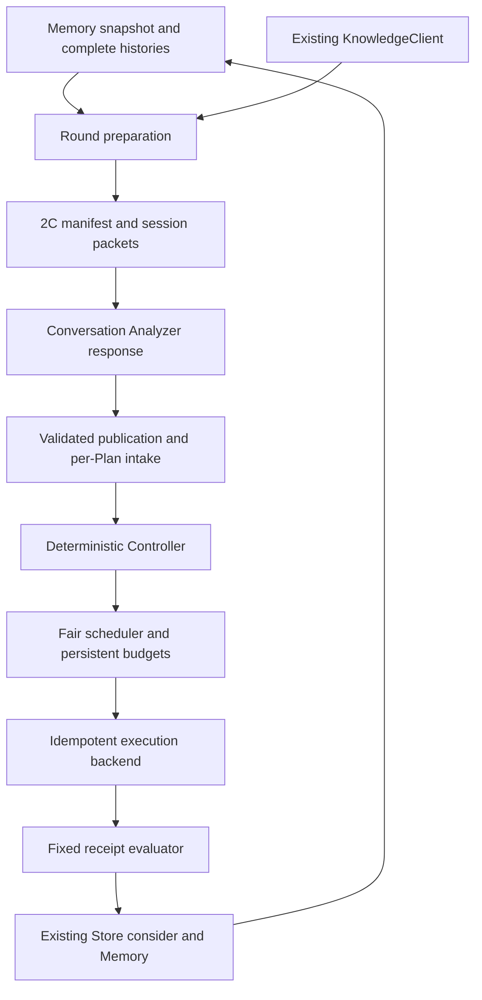

# Phase 2D+ Workflow / Controller implementation plan

2026-11-11. Scope: complete the local synthetic software loop, then stop for review. The current conversation model supplies Analyzer and repair responses. No model API, real Kernel, Colab or TPU work.

## Audit and compatibility

Read the actual 2A Store/contracts/artifacts, 2B Knowledge/Memory/associations, 2C inputs/Analyzer/output/session implementations and their guides, reports, plans and current roadmap. The immutable schema v1 supports new typed Decision notes and artifact payloads. No accepted runtime files or schema need modification. There is no public batch transaction: use deterministic append prefixes and a final completion marker; recovery repeats identical requests. Protected starting hashes and exact user request are archived in the phase2d manifest.

2C variants are text proposals, not executable code. Intake requires explicit source/config/build artifacts and a bounded execution specification per text variant. Generation means materializing those model-supplied immutable bytes; a failed materialization still has an honest declared source identity. No source bytes are invented from a digest. A multi-strategy publication retains separate single-Run AnalysisBundles.

## Architecture and ownership

- `workflow/intake.py`: verify 2C completion marker, replay and immutable bindings, current Knowledge references; persist accepted/rejected/waiting per Plan.
- `workflow/rounds.py`: all-strategy cards, selected complete histories, explicit parents, manifest/session preparation and publication using existing APIs.
- `workflow/journal.py`: existing Decision journal, canonical state digest, chain checks and single-host per-Task OS lock.
- `workflow/scheduling.py`: deterministic configurable weighted fairness, within-strategy priority, concurrency and cost reservation; no best-dependent pruning.
- `workflow/execution.py`: request/lookup/poll protocol, immutable request identity, durable synthetic receipts and isolated candidate workspaces.
- `workflow/evaluation.py`: verify receipts and fixed contracts; append Evidence/Evaluation/Profile and original Run transitions; only Store.consider updates Best.
- `workflow/controller.py`: lifecycle, resource ownership, bounded retry and explicit repair responses, recoverable integration.
- `workflow/__main__.py` and demo: one CLI for task/round/session/intake/status/run/recover/repair; standalone two-round synthetic example using production APIs.

## State and recovery design

QUEUED → GENERATING → COMPILING → CORRECTNESS_CHECK → BENCHMARK_READY → RUNNING → EVALUATING → COMPLETED or classified failure. Fine stages live in typed notes; existing Run remains ready/deferred/running/terminal. Candidate and Run creation is replayable before queue/admission completion. New source requires new Candidate; transient retry uses a new Run. Repair binds a new ParentCandidate to the exact failed Candidate and preserves the original Plan ancestor.

Persist admission and full cost reservation together before executing. Stage operation IDs derive from immutable Run and stage. A backend persists request and receipt in the original Store before acknowledgement. Recovery queries the same operation: completed → integrate, running → poll, definitely not started → submit the original request, unknown → pause for reconciliation. A completed experiment is never automatically submitted with a new operation. Store response loss replays the exact original event, expected predecessor and key. The OS-held Task lock prevents two Controllers claiming the same work and is released on process death. This is single-host orchestration, not distributed exactly-once execution.

Concurrency is logical: at most configured active jobs, with exclusive benchmark device ownership retained while pending. Cost reservations are conservative and charged once per attempt; tokens and time are explicit declared bounds, not fabricated model usage. Exhausted jobs remain deferred. Cancellation prevents new launches and reconciles existing operations. Weighted fairness is configurable per strategy; task best never removes another route.

The fixed contract pins Task.contract_revision, Workload.spec and full EvaluationContext fields plus evaluator policy. Correctness and timing are verified against matching synthetic receipts; synthetic provenance is mandatory. Faster/slower compares an eligible same-context parent result; promotion remains the existing 2A rule. Frontier and current parent use explicit deterministic policy, never LLM pointer writes.

## Tests and staged execution

1. Write failing tests for journal rebuild/lock, budget/fairness, intake publication/freshness/partial outcomes. Implement, run focused regressions.
2. Write failing backend/evaluator tests: immutable workspaces, all outcomes, tampered bindings/contracts/artifacts, durable receipt lookup and duplicate request conflicts. Implement without old runtime edits.
3. Write Controller tests for variable variants, mixed failures, bounded repair/retry, pause/resume/cancel and resource ownership. Verify recoverable prefixes and unknown-outcome handling.
4. Run actual A–G end-to-end cases through KnowledgeClient, Memory, 2C session/publication, intake, backend, evaluator and a second round. Automated model responses are explicitly recorded synthetic fixtures.
5. Crash tests cover candidate creation, compile pending, backend completed before integration, committed Store response loss, repair before scheduling, duplicate intake/results, out-of-order returns and process restart. Compare uninterrupted results and backend execution counts.
6. Independent fresh reviewer audits code/tests/spec; reproduce important findings, add failing regressions, fix and recheck.
7. Run full existing and new root suite, existing MCP tests, standalone demo, protected hashes and document links. Archive commands/output and precise limitations.
8. Update guide, current roadmap/index/weekly completion record with guarded writes. Preserve historical reports. Deliver 2D+ implementation/acceptance report; Phase 3 remains unstarted.

## Acceptance matrix

| Case | Required evidence |
|---|---|
| A | A/B, two Plans each, unequal variant counts, all admitted, independent Best |
| B | A leads, B improves and remains Frontier/eligible |
| C | compile/incorrect/timeout/invalid/success coexist and retain classification |
| D | exact repair ancestry, original failure, bounded count and cost |
| E | durable completion recovery without duplicate backend execution |
| F | new snapshot, A–E cards, complete A/B histories, second Analyzer PlanSet |
| G | duplicate publication/results and out-of-order completion preserve Best/history |

All timings and correctness in this phase are synthetic software fixtures. No claim of real compilation, loaded Kernel identity, hardware correctness or performance gain follows from these tests.
