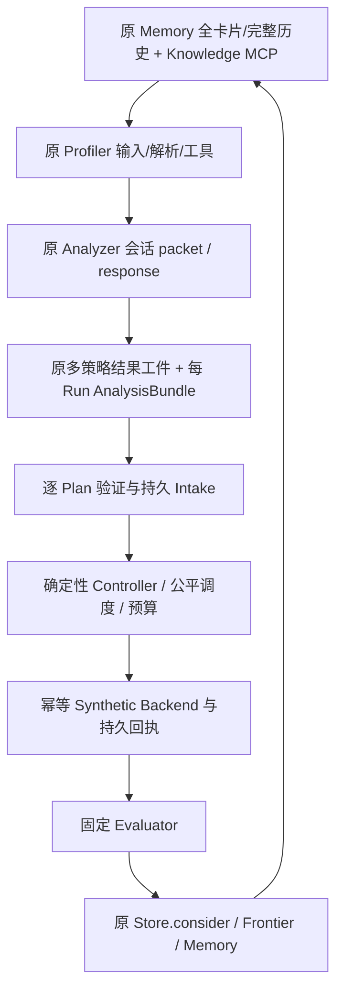

# Phase 2D+ Workflow / Controller 实现与验收报告

2026-11-11。2D+ 已实现并通过本地端到端软件验收，停在本阶段等待用户审查。Phase 3 未开始。原始请求逐字节保存在 [sources/phase2d-request.txt](sources/phase2d-request.txt)。

## 架构与交付



Controller 管流程、权限边界、预算、状态和调度；Analyzer 与明确提交的 repair response 承担推理。本轮没有新增模型 Provider/API/Key。原 2A schema v1、2B Memory/Knowledge、2C Profiler/Analyzer 与网站/MCP 运行时代码保持原样；[受保护起始哈希](protected-baseline.json) 与 [最终复核](protected-check.json) 逐项对应。没有第二实验数据库、Knowledge 服务或晋升算法。

| 文件 | 实际职责 |
|---|---|
| [intake.py](../../../src/rsi_kernel_agent/workflow/intake.py) | 重放已完成2C publication、实时来源与间接引用检查；逐Plan接受/拒绝/等待，一次原子保存，跨轮去重 |
| [rounds.py](../../../src/rsi_kernel_agent/workflow/rounds.py) | 全部状态卡、参与路线完整历史、冻结父选择、新manifest与快照 |
| [journal.py](../../../src/rsi_kernel_agent/workflow/journal.py) | 追加Decision状态链、摘要、过期写拒绝、同主机Task独占锁 |
| [scheduling.py](../../../src/rsi_kernel_agent/workflow/scheduling.py) | 可配权重公平性、策略内优先级、并发与一次性成本预留、剩余预算 |
| [controller.py](../../../src/rsi_kernel_agent/workflow/controller.py) | 候选生命周期、设备队列、暂停/延期/取消、修复/重试、恢复和结果集成 |
| [execution.py](../../../src/rsi_kernel_agent/workflow/execution.py) | submit/lookup/poll、稳定operation、原Store请求/回执、隔离工作区与合成后端 |
| [evaluation.py](../../../src/rsi_kernel_agent/workflow/evaluation.py) | 固定身份/契约/回执/正确性/计时/Profile检查，原Evidence/Bundle/Run/consider归档 |
| [统一CLI](../../../src/rsi_kernel_agent/workflow/__main__.py) / [demo.py](../../../src/rsi_kernel_agent/workflow/demo.py) | 创建Task、会话与Round入口、状态/队列/结果/失败/修复、恢复及独立两轮演示 |
| [接口指南](../../../docs/phase2d-workflow-controller.md) / [先行实施计划](../../../docs/superpowers/plans/2026-11-11-phase2d-workflow-controller.md) | 完整schema/API、状态映射、契约和Phase3接入边界 |

新增测试位于 `tests/test_workflow_*.py` 与 `tests/phase2d_fixtures.py`。精确修改/新增文件、前后SHA256与原文快照见 [changes.json](changes.json)。原2A/2B/2C验收报告未改写。当前路线图、工程/知识索引、Workflow说明与周记录同步维护。

## 数据、调度与生命周期

2C的variants是文字提议；2D要求每个文字变体显式绑定source/config/build工件、scenario、priority、device与成本。不同Plan可以有不同数量。Candidate在物化前已有声明身份，generation失败表示这些字节未能物化，不伪造已生成源码。每个Candidate独立目录，拒绝链接/junction，复制字节而非可写工件硬链接。

PlanSet必须来自原2C完成标记；manifest与Analyzer exchanges重放、Plan父绑定、单Run AnalysisBundle、Task/Workload/context和来源均核对。受影响Plan独立rejected/waiting，其他合法Plan继续。Intake聚合Decision一次原子保存，避免部分逐项提交后实时Knowledge变化造成恢复冲突。Controller仅接受对应类型与Task归属的完成标记。

固定契约包含原Task.contract_revision、Workload.spec及完整EvaluationContext环境/协议/provenance，加上固定evaluator policy；不重新定义容差或Benchmark。Evidence原始工件、Run与Candidate/父身份绑定后才能分类，晋升调用原`consider`。结果区分正确更快/更慢/不确定、生成/编译/执行失败、incorrect、invalid_measurement、incomplete和cancelled。

细分状态保存在workflow_state.v1：queued → generate → compile → correctness → benchmark → evaluate → completed/failed；未启动任务可deferred/cancelled，未知外部结果blocked。原Run使用现有ready/deferred/running/终态。正确但计时不足可以进入Last Correct，不能晋升Best。

调度按served/weight选策略，再按该策略priority和稳定ID选job。并发计入active/evaluating/blocked；相同设备的benchmark在可靠完成前独占。Task Best不决定其他路线是否取消。正确候选按固定策略保留Frontier；下一轮才按显式branch_best或explicit父策略调用MemoryWriter.select_parent，不能混用latest/best/current parent。

每attempt在执行前一次预留executions/tokens/time_s，execution至少1。失败不退款，恢复不重复扣费，耗尽保留延期。默认最大repair深度1、retry1，可配置。tokens/time_s为声明上界，未伪称真实模型token或硬件用时统计。修复必须提供当前会话响应、新源码和理由；新ParentCandidate精确指向失败Candidate，旧失败保留。未改源码的重试生成新Run，保留Candidate。

## 持久恢复与幂等

没有新增表。每个journal状态是已有Decision中的完整state、revision、previous_id与digest；Task OS文件锁防止两个Controller同时调度，进程死亡释放。预算预留先于后端调用。请求/回执使用稳定operation ID和摘要，后端先持久化receipt再确认；恢复查到completed只补归档，running继续poll，definitely_not_started才提交原请求，unknown保持阻塞。

Evidence/Evaluation/Profile/RunEvent/consider使用确定性ID和请求键重放，最后保存结果完成标记。原transition的expected_event_id不随重试改变。固定评估意图在结果前缀前持久化，晚到取消不能改变原评估payload。暂停先写journal再同步原paused/resumed Decision，可在恢复时补齐。

9项恢复测试中8项使用真实子进程`os._exit(73)`，分别终止在Candidate提交、compile请求、benchmark回执、Run终态、consider晋升、repair意图、pause提交、result完成后取消等边界；另1项验证未知结果恢复、暂停和设备独占。测试额外用fsync外部日志计数实际Synthetic benchmark完成调用，确认已完成操作没有再次执行，不只检查去重后的数据库记录数。专项9/9通过，121.436秒。

## 独立CLI演示

实际运行：

```powershell
$env:PYTHONPATH = Join-Path (Get-Location) 'src'
& '.\knowledge-site\.venv-mcp\Scripts\python.exe' -B -X utf8 -m rsi_kernel_agent.workflow demo --output '.artifacts/phase2d-2026-11-11/synthetic-demo'
```

退出码0。使用原MCP `build_server` 的隔离笔记目录、原KnowledgeClient、Memory、Analyzer session和所有新生产接口；不导入测试编排器。完整输出为 [report.json](../../../.artifacts/phase2d-2026-11-11/synthetic-demo/report.json)，便于快速检查的统计为 [demo-summary.json](demo-summary.json)。

| 输出 | 实际结果 |
|---|---|
| Task / Round | demo-task；demo-round:1、demo-round:2 |
| 全策略状态 | 两轮均包含A、B、C、D、E，参与分析A/B |
| 第一轮Plan与变体 | A两Plan、B两Plan；变体数2/1/1/2；另有1次修复 |
| 第二轮 | 重新读取新snapshot和完整历史，4个新Plan各1变体 |
| Candidate / Run | 各13条，含2个基线和11个workflow尝试 |
| 分类 | correct_faster 6、correct_inconclusive 1、compile_failed/incorrect/incomplete/invalid_measurement各1 |
| Best与探索 | A/Task 7 ms，B 9 ms；B保留Frontier；**数值全部synthetic** |
| 历史读取 | 第一轮A/B各20条；第二轮A152条/B130条，均含必要依赖且complete |
| 成本/终态 | 预留11 executions、0 tokens、0.11 s声明成本；workflow completed，失败事实保留 |

这里completed表示软件流程完成，不表示所有候选成功。修复无可比的已确认失败父计时，因此其分类为correct_inconclusive，仍可按原Store规则参与Best。未产生真实硬件验证。

## 验收证据

最终根级完整套件 **230项：229通过、1跳过、0失败/错误**，其中2D+新增68项全部通过；耗时587.706秒。既有只读MCP **5/5通过**。跳过沿用Windows symlink创建权限不足（WinError1314），junction及其他路径测试通过，未放宽权限。环境仍为Python3.13.14、SQLite3.53.1、MCP1.30.0、Pydantic2.14.2。asyncio fixture的slow-callback诊断保留在原日志，不当作硬件计时。命令与环境见 [test-environment.json](test-environment.json)，原始输出见 [tests.txt](tests.txt)、[existing-mcp-tests.txt](existing-mcp-tests.txt)。

```powershell
& '.\knowledge-site\.venv-mcp\Scripts\python.exe' -B -m unittest discover -s tests -v
# knowledge-site目录：
& '.\.venv-mcp\Scripts\python.exe' -B -m unittest test_mcp.MCPTests -v
```

| 用户案例 | 实际覆盖 |
|---|---|
| A 多路线正常 | Controller variable_variants；原intake/session，4Plan/6候选；独立Best |
| B A领先、B继续 | Controller variable_variants及两轮Demo；B从12到11再到9的synthetic记录、Frontier保留 |
| C 混合失败 | Controller mixed_failures；Demo同时含编译/正确性/timeout/invalid/success；执行器含generation/execution/incomplete/inconclusive |
| D 有限修复 | Controller repair_new_source、retry_retains；Demo精确repair ancestry；成本/次数界限 |
| E 中断恢复 | 9项recovery：真实进程退出与backend调用计数；原终态与晋升不重复 |
| F 多轮递归 | 原MCP+session的two_rounds Demo；新父/新快照/ABCDE卡片/A/B完整历史 |
| G 幂等与乱序 | publication同轮/跨轮去重；重复integration；Controller out_of_order旧9 ms晚于新7 ms返回，A Best仍7、Task Best仍2，latest保持新Run |

TDD先观察缺失模块或实际缺陷RED，再实现；最终组合Demo和后补Controller乱序验收首次运行通过，不虚称其经历缺失实现RED。组件初次整合发现旧detached job引用导致丢失operation、receipt状态名称不匹配、同Candidate retry备注键冲突，均定位后修复；原测试期望也按实际Store.best返回dataclass、Frontier返回ID数组纠正，没有降低旧测试标准。

专项回归另外发现并修复：预算延期投影延迟、unknown→running不轮询、未知结果确认未启动后仍误执行取消工作、暂停Decision/journal提交裂缝、晚到取消改变已提交评估、普通note冒充intake标记。相关RED/GREEN日志和辅助脚本在 `.artifacts/phase2d-2026-11-11/`，不是运行时依赖。

独立reviewer无实现会话历史，检查实际源码/测试/指南，并复现unknown恢复缺陷、重跑17项执行测试和修复专项；最终审查范围无未关闭Critical/Important，详见 [independent-review.md](independent-review.md)。保留规范数据库路径等非阻塞边界，不声称审查证明所有可能问题不存在。

本周完成记录已补充，仅记录已验证结果，不勾选其他任务。本地revision API检查返回401，未读取认证文件；采用原字节快照、写前SHA检查、重新读取合并与原子替换，保留其他新增记录。文档相对链接与最终SHA清单见 [links.json](links.json) 和 [changes.json](changes.json)。

## 限制与停止点

- 本地软件实现与synthetic数据已经区分。没有执行源码编译/Kernel、真实correctness oracle、真实硬件计时、TPU或MLA优化；Profile为带synthetic绑定的保存格式fixture，未接入原始XPlane解码。
- 当前支持同主机单Task Controller协议及其设备队列；跨Task或远端共享设备需要Phase3的可信设备仲裁。Controller应使用同一规范数据库路径，未验证数据库硬链接/异名symlink别名。不是分布式恰好一次执行保证。
- 设备独占当前针对同Task同设备的benchmark彼此；generate/compile/correctness为软件模拟，可与benchmark交错。真实接入前需补设备容量/许可、跨Task仲裁及其他耗设备阶段隔离，不能据此宣称实测环境已受控。
- repair采用显式响应策略，全部已归类失败可提交新源码；未按错误类型自动选择修复方法或在次数耗尽时自动暂停策略，耗尽时拒绝并保留失败。原代码retry仅允许execution_failed/incomplete。tokens/time_s是声明成本预留，不计先前Analyzer/repair推理消耗，也不是wall-clock watchdog；timeout为合成情景。
- 真实执行端必须提供可靠operation查询/幂等与可信receipt。unknown不会被当作未执行；其资源预留保持，需查证。当前取消不强杀外部活动。
- journal完整状态和Memory全历史加载随记录增长，未做大规模性能测试；设备锁与SQLite验证不等于断电持久性验证。备份须同时保留一致DB和工件树，不能仅复制活动WAL主文件。
- Store低层可信写入仍可绕过应用语义；本协议不是账号授权系统。Knowledge实时检查不构成跨系统原子快照，旧publication不自动升级为新来源版本。
- Python/SQLite/MCP均复用原环境，无安装升级。Windows symlink权限限制保持原样；没有读取认证文件或修改`.auth`、账号权限、CLI/全局Codex配置。
- Git CLI不可用；只复核既有main / HEAD `260de63fb57f5f494326936cdfbead188e10df01`，不声称工作树干净，没有提交。

后续Phase3需将现有adapter接口接到已有Colab执行能力，核验可信oracle、实际加载身份、受控timing与Profile回收，先验证未修改MLA基线。当前仅交付该接入边界；**停在2D+等待用户审查，Phase3未开始。**
