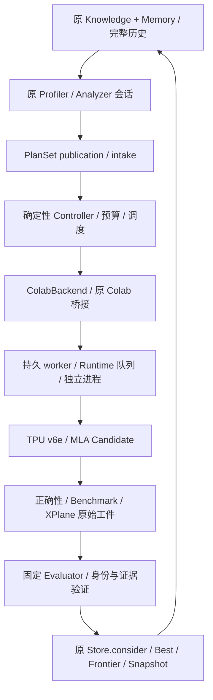

# Phase 3 真实硬件集成与优化实现进展报告

<!-- p35-upload-status -->
> **上传前状态核验｜2026-11-13 19:07（Asia/Shanghai）**：P3.5 仍未完成最终验收。ABBA 已完成，program 有有限复测收益，host 漂移导致联合结论 inconclusive；恢复后的第二轮硬件实验和单 tile 诊断尚未执行。Runtime 4 的 attention 负例已在本地收齐 generate/compile 成功回执，correctness 请求已持久化但最终回执尚未回收；其他三项准入 Run 为 not_run。
>
> **当前没有运行中的本地准入驱动。** 原驱动于 18:53:28 退出，退出码 −1；原远端 worker 未被停止，最后保存的远端阶段观察为 18:53:03 running，但本次上传前只读核验没有再次查询远端最终状态，不能据此判断它现在仍在运行或已经完成。恢复时必须先查询同一 operation。Controller revision 146，预算保持 **10/16 executions、18000/28800 声明秒**；当前 Store 为 835 records / high-watermark 860，与已保存 Snapshot version 11 的 818/843 分开记录。
>
> 最新根级完整回归：**321 项，318 通过、3 跳过、0 失败/错误，423.235 秒，exit 0**。见[上传前只读事实](p35-upload-progress-facts.json)、[完整日志](p35-root-tests-runtime4-20261113.txt)与[退出码](p35-root-tests-runtime4-20261113-result.json)。已找到本机既有 Git 2.54.0 并确认原 GitHub 远端，本次按用户要求整理源码、辅助工具和报告上传；以下早先关于 Git 不可用或驱动运行中的表述均保留为历史。
<!-- /p35-upload-status -->

<!-- p35-runtime4-progress -->
> **P3.5 最新进展｜2026-11-13 18:40（Asia/Shanghai，进行中）**：Runtime 3 的五项准入及 ABBA 四个 Run 已完成并核验。ABBA 的 program 两对 median 降低约 **6.50% / 5.92%**，但 host 为 `inconclusive_drift`，联合结论仍为 `inconclusive`，未确认稳定端到端收益。第二轮已从 Snapshot version 10 读取新历史，生成四个新 Plan/Candidate；随后 Runtime 3 消失，**四项均没有 durable 远端提交请求或回执，不能算作第二轮硬件执行**。
>
> 原未提交作业已通过原 Evaluator 与 Journal 归档：首项为 cancelled / incomplete，其余三项保留 not_run；Task 未取消，已扣预算不退回。归档 Snapshot 为 **version 11 / 818 records / high-watermark 843**，预算仍为 **10 / 16 executions、18000 / 28800 声明秒**。旧 Context、源码和 operation intent 全部保留。
>
> **18:28:57 已由原申请流程取得 Runtime 4** `tpu-v6e1-s-euw4a0-1xqzeyr91qwmg`，申请循环随后正常结束。固定版本隔离环境 ready，真实同步 JAX 探针 **140.0**，单 TPU v6 lite／单进程。新环境四项重新准入正在执行，尚未宣告通过；恢复优化轮和独立 single-tile 零长度诊断仍待真实完成。详见[新环境](environment-isolated-runtime4.json)、[探针](isolated-probe-runtime4.json)、[原作业归档](../../../.artifacts/phase3-2026-11-12/real-round-2/runtime-loss-archive.json)、[ABBA 结论](../../../docs/phase3/phase3-p35-abba-results.md)与[恢复计划](../../../docs/phase3/phase3-p35-runtime4-recovery-plan.md)。以下带时间记录保留为历史。
<!-- /p35-runtime4-progress -->

<!-- p35-abba-complete-progress -->
> **P3.5 更新｜2026-11-13 17:28（Asia/Shanghai，进行中）**：五项 Runtime 重新准入与四项 C–T–T–C 独立确认均已完成并核验。ABBA 的 program 两对 median 分别降低约 **6.50% / 5.92%**，通过预设 program 判据；host 存在明显跨 Run 漂移，结论为 **inconclusive_drift**，联合判定 inconclusive，仍不宣称稳定端到端加速。确认结论已写入原 Memory，第二轮新 Snapshot/Analyzer 正在准备。完成快照 version 8 / 770 records / high-watermark 795；预算累计 9 / 16 executions、16200 / 28800 声明秒。最新根回归 **321 项：318 通过、3 跳过，567.523 秒，exit 0**。详见 [ABBA 结果与完整证据](../../../docs/phase3/phase3-p35-abba-results.md)。以下旧时间段落保留为历史，第二轮及单 tile 硬件诊断尚未完成，P3.5 仍未最终验收。
<!-- /p35-abba-complete-progress -->

<!-- p35-admission-complete-progress -->
> **P3.5 更新｜2026-11-13 16:21:07（Asia/Shanghai，进行中）**：新 TPU v6e 的五项重新准入已完成并独立复核，**5 verified、0 pending、0 failed**，核验 198 个去重工件、517,816,053 bytes；原始 NPZ attention/cache 已重算。两个故意错误的 Candidate 均被 Oracle 拒绝；A 基线、delayed-store-wait 与独立 B control 均通过三组正确性及五阶段执行。三项准入 small host median 分别为 0.232400、0.217205、0.228915 ms；这些单次准入值不构成稳定收益结论。
>
> 确认轮已通过原 Analyzer：2 Plan / 4 变体，review 无结构性降级、winner_selected=false；输入 Snapshot version 7 / 579 records / high-watermark 604，B 路线完整历史含依赖共 315 条。已冻结 C–T–T–C 顺序与 2%/5% 判据。最近保存的 Controller revision 86 状态为：p35-control-before：blocked/compile；p35-treatment-first：queued/generate；p35-treatment-second：queued/generate；p35-control-after：queued/generate。原探索预算已用 6 / 16 executions、10800 / 28800 声明秒。桥接 unknown 按原 operation 查询恢复，不盲目重跑。ABBA、第二轮与独立单 tile 硬件诊断尚未完成。
>
> 本次根级测试 321 项（318 通过、3 跳过），625.063 秒，退出码 0；完整 P3.5 辅助专项 68 项通过，103.970 秒。新增诊断派发专项 7 项通过，48.541 秒，退出码 0；均为本地测试，不代替硬件验收。 [五项准入核验](../../../.artifacts/phase3-2026-11-12/runtime3-prerequisite-verification.json)、[确认轮](../../../.artifacts/phase3-2026-11-12/confirmation-f686274a57bb7ebb/selection.json)、[确认轮状态](../../../.artifacts/phase3-2026-11-12/confirmation-f686274a57bb7ebb/controller-status.json)。
>
> 以下带旧时间的段落保留为历史记录，以本次更新为较新进展。
<!-- /p35-admission-complete-progress -->

<!-- p35-progress-2026-11-13T07:15:54Z -->
> **P3.5 最新进展｜2026-11-13 15:15:54（Asia/Shanghai，进行中）**：本次继续执行已于 15:08:13 获得新的 TPU v6e Runtime `tpu-v6e1-s-euw4a1-39sjw4nm2h4b9`，隔离环境 ready，真实同步 JAX 探针返回 `140.0`。新环境为 Python 3.11.17、JAX/jaxlib 0.8.1、libtpu 0.0.30、单 TPU v6 lite／单进程。五项重新准入 Run 已写入原 Store，正在按顺序执行：attention 负例、cache 负例、A 修复基线、B delayed-store-wait、原 B 基线独立 control；**尚未宣布这五项 Gate 通过，ABBA、single-tile 零长度硬件诊断和第二轮优化尚未完成，稳定性能收益仍未确认**。
>
> 15:15:54 的只读事务看到当前任务历史 **462 records / high-watermark 487**，最新已保存 Snapshot 仍是第一轮的 **version 5 / 443 records / high-watermark 468**；两者不是同一时点。五个新 Run 均存在，attention 负例最新事件为 running/active，其余四个尚无 RunEvent，尚无新准入最终结果文件。原探索 Controller 仍为 revision 78、5 个历史作业、已用 **5 executions / 9000 声明秒**，总限额 **16 / 28800**；重新准入成本单独记录，预算未重置。
>
> 根目录完整测试已于本次重新运行：**321 项，318 通过、3 跳过，625.063 秒，exit code 0**。ABBA 统计 19 项及单 tile 诊断准备 8 项的本地专项各自通过；包含完整辅助链路的最终专项重跑仍在进行，不能提前宣告全部通过。证据与限制见 [P3.5 进行中验证记录](../../../docs/phase3/phase3-p35-final-validation.md)、[新环境](environment-isolated-runtime3.json)、[同步探针](isolated-probe-runtime3.json)、[根测试日志](../../../.artifacts/phase3-2026-11-12/p35-root-tests-2026-11-13.txt)。**以下保留原报告历史正文；其中“当前无 Runtime”“今天未重新运行整套”等旧时点表述，由本段及带时间的新验证记录更新。**
<!-- /p35-progress-2026-11-13T07:15:54Z -->


**2026-11-13｜已接通真实 Colab TPU v6e，完成 MLA Decode 基线、正确性负例、真实 Profile，以及第一轮4个 Plan、5个 Candidate 的实验。第二轮尚未开始，Phase 3 尚未完成最终验收。**

第一轮五个候选均通过固定正确性检查；`delayed-store-wait` 的单次计时低于父版本，另外四项按原规则分类为更慢。**目前没有经过独立 Run 复测确认的稳定性能收益**，不能将一次 Best 晋升等同于优化目标已经达成。

截至 **2026-11-13 10:04（Asia/Shanghai）**，原桥接控制面查询成功、Runtime分配列表为空。昨晚22:54曾申请到新的v6e，但尚未完成环境准备或执行实验，今天该Runtime已不在列表中；申请循环在分配成功后正常退出，目前没有运行中的申请循环。最新只读结果见 [状态快照](status-at-report-2026-11-13.json)。本次按用户要求整理报告，没有新申请或执行TPU。

原始任务保存在 [phase3-request.txt](sources/phase3-request.txt)。本报告汇总实际代码、测试与真实实验；Phase 2A–2D+历史报告保持原样，旧版Phase 3总报告已按原字节备份至`before/`。

## 阶段与验收状态

| Gate | 当前状态 | 证据与范围 |
|---|---|---|
| P3.0 审计与历史恢复 | 已完成本轮目标 | 四目录、原系统接口、Forward/Decode、Colab桥接已审计；project2索引及136条历史记录、Knowledge方法和实施计划已保存 |
| P3.1 真实执行接入 | 已有真实验证 | 原桥接连接实际v6e、同步最小JAX运算、持久worker/回执及正式Kernel阶段均运行过；历史成功不代表今天仍有在线Runtime |
| P3.2 Trusted Baseline | 在明确范围通过 | Decode contiguous BF16的small/boundary/default正确性、两类错误负例、A/B独立基线与源码身份；正式计时仅small |
| P3.3 真实Profiler | 在明确范围通过 | XPlane回收、原duration parser、绑定Evidence、normalization与原Analyzer读取；未取得独立DMA/VMEM/MXU测量能力 |
| P3.4 第一轮真实优化 | 已完成首轮执行 | 4 Plan / 5候选真实编译、正确性、Benchmark、Profile、Evaluator与Memory归档；稳定收益尚待复测 |
| P3.5 多轮真实RSI | 未完成 | 目前只有一轮真实优化；第二轮新证据分析、计划、实验和受控复测尚未执行，不申请最终闭环验收 |

当前真实执行范围为 **MLA Decode contiguous接口**。MLA Forward已审计并恢复历史，但尚无本轮独立真实Task、Baseline或优化Run；Decode paged、其他dtype、更多mask/window/cap配置未完成本轮硬件验收。

## 架构与文件交付



Controller继续负责确定性流程、预算与恢复；当前对话模型通过原packet/response/session提供分析、Plan和Candidate修改，没有新增模型API或Key。沿用schema v1、唯一ExperimentStore/ArtifactStore、原Knowledge MCP、Memory、Profiler/Analyzer及原`consider`。真实执行的兼容扩展集中于workflow层，没有第二个实验数据库、Controller或晋升算法。

| 文件 | 实际交付 |
|---|---|
| [colab_bridge.py](../../../src/rsi_kernel_agent/workflow/colab_bridge.py)、[colab_bridge_call.py](../../../src/rsi_kernel_agent/workflow/colab_bridge_call.py) | 原ColabRuntime/ContentsClient接入；固定Runtime身份、代码提交、文件同步与结果回传 |
| [colab_remote.py](../../../src/rsi_kernel_agent/workflow/colab_remote.py)、[colab.py](../../../src/rsi_kernel_agent/workflow/colab.py) | bootstrap、submit/lookup/poll、工件校验和原Store回执归档；分块缓存与续传 |
| [colab_worker.py](../../../src/rsi_kernel_agent/workflow/colab_worker.py) | 远端持久执行意图、同Runtime跨合作Task串行队列、独立stage进程、原子完成回执与unknown恢复 |
| [real_protocol.py](../../../src/rsi_kernel_agent/workflow/real_protocol.py) | source bundle、固定Oracle/runner/协议、加载路径与字节身份、环境、case、计时和Profile绑定核验 |
| [mla_baseline.py](../../../src/rsi_kernel_agent/workflow/mla_baseline.py)、[mla_runner.py](../../../src/rsi_kernel_agent/workflow/mla_runner.py) | 权威源码只读打包、workload矩阵、独立参考、真实编译/正确性/原Benchmark/原parser调用 |
| [execution.py](../../../src/rsi_kernel_agent/workflow/execution.py)、[intake.py](../../../src/rsi_kernel_agent/workflow/intake.py)、[controller.py](../../../src/rsi_kernel_agent/workflow/controller.py)、[evaluation.py](../../../src/rsi_kernel_agent/workflow/evaluation.py)、[CLI](../../../src/rsi_kernel_agent/workflow/__main__.py) | 原流程兼容real阶段与后端；保留synthetic路径、状态机与晋升规则 |
| `tests/test_phase3_*.py`、[phase3_fixtures.py](../../../tests/phase3_fixtures.py) | 八组真实协议/桥接/backend/worker/remote/runner/baseline/CLI本地测试；硬件证据另行归档 |
| [真实接口指南](../../../docs/phase3/phase3-real-execution.md)、[恢复指南](../../../docs/phase3/phase3-worker-recovery.md)、[先行实施计划](../../../docs/phase3/phase3-implementation-plan.md) | 实际接口、固定协议、恢复和信任边界；旧日期记录的阶段进度以本报告为准 |

`.artifacts/phase3-2026-11-12/`存放本轮辅助编排、独立Candidate、会话和核验工具；正式数据仍为唯一`experiments.sqlite3`及同级`artifacts/`。远端spool是执行恢复账本，不是第二套Memory。17个受保护2A/2B/2C模块保持起始哈希；清单见 [changes.json](changes.json) 与 [受保护检查](runtime-current-check.json)。

## 四目录审计与历史知识恢复

| 实际目录 | 本轮角色 |
|---|---|
| `C:\Users\fengluo\Desktop\rsi-kernel-agent` | 唯一RSI主项目；代码、测试、文档、Store、Candidate工作区 |
| `C:\Users\fengluo\Desktop\training\PallasKernels` | 当前Kernel权威源码；审计Forward/Decode、reference、registry、benchmark和parser，未覆盖原实现 |
| `C:\Users\fengluo\Desktop\project2` | 历史知识来源；按日志、manifest、diff和明确commit关系恢复，不用mtime猜父链或直接导入当前Best |
| `C:\Users\fengluo\Desktop\colab` | 复用既有google-colab-cli；Windows本地编排，TPU位于远端Colab VM，未替换成另一套Local Runtime方案 |

project2索引收录 **74,382个相关路径**，不代表逐文件完整阅读；结构化恢复 **136条实验记录**，包括Forward 28条、Decode 108条。离线核对935次源码哈希、1,044个最新包工件，并从保存样本重算100条计时记录。未知源码父关系保留unknown，部分早期ZIP缺失不补造。

历史原分类为98条MEASURED、24条COMPILE_FAIL、8条CORRECTNESS_FAIL、4条REJECT_LSE_COMPILE和2条passed。这些是历史资料，不是本轮新执行的TPU结果；不同硬件、shape、dense/native范围和软件版本分开记录，未重跑所有历史正确性或解码全部XPlane。

通过原KnowledgeClient/MCP保存并回读了 **10项历史方法与2项官方来源方法**，保留路径、SHA、摘录、revision、适用条件和未知项。缺少正式Run契约的历史保存为有来源知识，不伪造Run或`locally_verified`。

详见 [接口审计](../../../docs/phase3/phase3-project-integration-audit.md)、[Kernel审计](../../../docs/phase3/phase3-pallaskernels-audit.md)、[Colab审计](../../../docs/phase3/phase3-colab-connectivity-audit.md)、[历史总览](../../../docs/phase3/phase3-project2-history.md)、[历史核验](history-verification.json)、[历史方法导入](history-knowledge-import.json)、[官方方法导入](official-knowledge-import.json)。

## 真实环境、基线与固定验证契约

首个Task为`mla-decode-v1`，实际入口`build_mla_decode_contiguous`，经原registry和固定runner调用。输出是contiguous BF16 attention及完整、独立的updated cache，输入cache必须保持原状；不省去必要prepare、append或完整cache输出。

权威入口SHA256为`e53b0e5ccff3ecf18192f30ef179cdb207c177f2f2dac48b2a08f40acc5000a6`。首次真实编译在boundary遇到padding/切片兼容问题；保留失败，独立repair把整批new-KV padding移到按batch切片之前，修复入口SHA为`2fc23aa9d0358ea18698f916cbc7ed5e02a4218dec2de2fc955661a8b513ebae`。这是建立可执行基线的兼容修复，不计作优化轮次或收益。

| 正确性case | Batch / Heads / capacity | latent / RoPE / block | 已覆盖检查 |
|---|---|---|---|
| decode-small | 1 / 16 / 1024 | 512 / 64 / 1024 | 小规模；唯一正式Benchmark/Profile case |
| decode-boundary | 3 / 16 / 256 | 128 / 64 / 128 | lengths `[0,1,129]`、opaque NaN tail/padding、全无效行及cache保留 |
| decode-default | 8 / 16 / 16384 | 512 / 64 / 1024 | 默认规模、多batch、多tile |

冻结的独立参考在CPU子进程运行，Candidate在TPU运行，两边使用相同保存输入。attention检查shape/dtype、有限性、逐元素`atol=rtol=0.01`及max abs/max rel/RMS；完整cache按BF16原始位比较，允许保留约定的opaque NaN区域。未修改Reference、放宽容差或删除失败case。window=0、soft_cap=0，其余配置不在本轮验收范围。

Runtime 2实际观测为单设备 **TPU v6 lite（v6e）**、单进程；Python3.11.17、JAX/jaxlib0.8.1、libtpu0.0.30、TensorFlow2.20.0、xprof2.22.1。使用远端RSI目录内隔离环境，本地/全局环境未升级；最小JAX运算同步后返回140.0。每个stage实测环境须与不可变Context匹配。见 [环境指纹](environment-isolated-runtime2.json)、[真实探针](isolated-probe-runtime2.json)。

原Benchmark协议`mla-contiguous-host-sync-v1`：编译单独记录，5次warmup、20次原始样本，所有输出pytree `block_until_ready`，不剔除outlier，保存median/mean/std/min/max/P25/P75。正式数值是 **host synchronized public-call latency**，包含prepare、attention、完整cache输出和主机派发/等待；预先输入准备、host→device传输与编译不在样本内，不能称纯设备Kernel时间。

| Runtime 2独立基线 | 三组正确性 | small host median / mean | Profile program / prepare / attention median |
|---|---|---|---|
| A | 全部通过 | 0.193195 / 0.195683 ms | 6.624375 / 0.694375 / 5.055625 μs |
| B | 全部通过 | 0.215365 / 0.218733 ms | 6.615000 / 0.693750 / 5.070000 μs |

A/B的source/config/build相同，各自拥有Candidate、Run、五阶段回执和Profile，未复制测量。相同字节约11%的host median差异提示跨Run波动，不能当作优化。两基线均valid、confirmed=true；缺少该Run绑定的可比父计时，分类为`correct_inconclusive`。Runtime 1的0.220715 ms保留原Context，不与新Runtime直接计算加速比。

两个故意错误Candidate分别破坏attention/cache输出，均被固定Oracle拒绝，独立NPZ重算确认两类错误。Run为incorrect、confirmed=false，无Benchmark/Profile请求。原`consider`保留eligible=false和未晋升Decision，没有删除失败。详见 [基线报告](../../../docs/phase3/phase3-baseline-report.md)、[基线复核](runtime2-baseline-verification.json)、[负例核验](oracle-negative-verification.json)。

## 真实 Profile 与 Analyzer

Profile在正式Benchmark后单独operation采集，属于预先固定的同一逻辑Run；保存原始XPlane、parser输出、normalized Profile、源码/环境/operation绑定与摘要。解析复用权威仓库`tools/tpu_duration_profile.py::read_profile`。

| 信息 | 本轮证据等级 |
|---|---|
| 同步host样本 | measured，来自正式Benchmark |
| program / prepare / attention duration | trace-derived，来自真实XPlane与原duration parser |
| 工作量、逻辑payload、pipeline假设 | theoretical / model_predicted，不是物理资源测量 |
| 独立DMA、完整Wait/Sync、VMEM/MXU利用率、critical path | 正式parser不提供，保持unavailable |

父子事件、重叠事件、不同clock domain不能直接相加。独立最小JAX诊断实际测试四种TRACE模式，HOST/XLA/COMPUTE/COMPUTE_AND_SYNC保存0/16/16/134个TPU事件，结果均129.0；trace内取标量额外产生slice/squeeze/copy，不把全部事件归因于五次主计算，也不扩称MLA资源计数能力。

原Analyzer已通过AnalysisInputManifest读取真实Profile、代码、历史与Knowledge。见 [Profiler报告](../../../docs/phase3/phase3-profiler-report.md)、[TRACE核验](trace-mode-verification.json)、[Analyzer读取](real-profile-analysis-smoke.json)、[官方版本审计](../../../docs/phase3/phase3-official-reference-audit.md)。

## 第一轮真实优化：4 Plan / 5 Candidate

轮次为`real-runtime2-round:1`，实际走原`prepare_round → Analyzer session → publish_result → intake → Controller`。输入包含全部3条策略卡片、参与A/B完整历史97/130条；manifest SHA为`5aff21e4175670eae1546c56e4897f12dfb3c289d129ab8db0cd8381453e8bec`。

当前会话完成源码/历史/Profile/Knowledge读取、8项数学工具计算及四个Plan；原session保留3次response，`model_transport=conversation_session`、`review_enabled=true`、`winner_selected=false`。未在实验前强选唯一赢家，没有独立模型API。

| Strategy / Plan | Candidate与变化 | 原Evaluator分类 | small host median | Profile program median |
|---|---|---|---:|---:|
| A / R1-A-tile | tile512：源码不变，small block 1024→512 | correct_slower | 0.225485 ms | 8.090000 μs |
| A / R1-A-tile | tile256：源码不变，small block→256 | correct_slower | 0.202570 ms | 11.127500 μs |
| A / R1-A-single | single-tile：静态单tile分支省去初始零状态在线softmax更新 | correct_slower | 0.193550 ms | 6.580625 μs |
| B / R1-B-store | delayed-store-wait：同tile内store.wait推迟至body返回前 | correct_faster | 0.183795 ms | 6.190000 μs |
| B / R1-B-compact | compact-new-row：prepared new由[B,T,Dpad]缩为[B,1,Dpad]，attention内广播 | correct_slower | 0.221875 ms | 6.588750 μs |

**五项均完成真实五阶段执行，三组正确性通过、timing_validity=valid、confirmed=true。** 候选独立工作区、父关系和source/config/build身份齐全。执行source bundle为375文件，权威审计清单390文件属于不同范围；未覆盖原Kernel或更改Oracle/Benchmark规则。

较小tile的program时长明显回退；compact准备阶段略短，但整体program没有明确收益且host更慢；single-tile接近基线。delayed-store-wait值得复测，但单Run不足以证明稳定收益，也不能证明差值全部来自DMA重叠。

A Branch Best保持修复基线，B及当前Context的Task Best由原`consider`晋升为delayed-store-wait；其余非晋升Decision与尝试保留。结果已写回原Memory，完成snapshot为version5、443 records、high-watermark468。**尚未运行第二轮读取新证据后的推理与实验。**

原探索预算16 executions / 28800声明秒；已使用5 / 9000，剩余11 / 19800，未因换Runtime重置。tokens预留0不代表会话推理没有成本，声明秒不是实际TPU计费或wall-clock统计。环境准入和负例成本单独记录，不包含在这5次探索计数内。

最终只读复核为5 verified、0 pending、0 failed，核对274个去重工件、519,513,865 bytes，重算三组NPZ attention与完整cache、回执/Evidence闭包、原样本统计及保存parser的normalization；未独立重新解码XPlane protobuf。详见 [实验报告](../../../docs/phase3/phase3-optimization-report.md)、[Analyzer结果](../../../.artifacts/phase3-2026-11-12/real-round-1/result.json)、[Candidate工件/diff索引](../../../.artifacts/phase3-2026-11-12/real-round-1/candidate-artifacts.json)、[完成快照](../../../.artifacts/phase3-2026-11-12/real-round-1/completed.json)、[五项最终核验](../../../.artifacts/phase3-2026-11-12/real-round-1/local-verifications/20261112T140159968103Z-r78.json)。

## 持久恢复、失败与 Runtime 状态

operation_id由Run/stage稳定生成，request_digest绑定契约和身份。worker先持久执行意图，再执行并原子发布回执；本地只接受完整工件闭包。completed回收原结果，running继续poll，definitely_not_started才能提交原请求，unknown阻塞核查。沿用原journal、幂等和`consider`，不声称分布式恰好一次。

设备协调覆盖同Runtime合作Task及全部实验阶段；检查可见进程设备占用，发现干扰或缺乏可见性时拒绝有效计时。不能证明隐藏进程、全部采样间隔的绝对物理独占，不强杀用户Notebook。

| 事件 | 实际处理 |
|---|---|
| 原基线boundary编译失败 | 原失败保留；独立兼容repair后验证，不改变Reference或原仓库 |
| Runtime 1消失 | 完成基线工件保留；未取得提交证据的负例尝试记incomplete，不虚报Kernel执行失败 |
| tile512桥接中断 | Controller保留blocked；同operation查询completed后只回收回执，没有重做已完成操作 |
| 用户临时要求使用TPU | 本地循环停止、持久暂停、检查可见设备空闲；明确恢复后继续原journal，未终止用户任务 |
| Runtime 2消失 | 五项完成且工件已回收；原Context、结果与Best保留，没有需盲目重跑的未知活动实验 |
| Runtime 3分配 | 2026-11-12 22:54:16上海时间返回allocated，申请循环正常结束；未建立隔离环境、真实探针或准入Run |
| 2026-11-13复查 | 10:04控制面assignments=[]；Runtime 3已不在列表，原因未知。旧ledger只证明曾分配，不证明当前在线 |

换Runtime的辅助绑定/重新准入逻辑已完成本地验证：旧轮次固定原环境；实测新环境后新建Context/Run，重新验证A基线、B的delayed-store-wait父候选与错误负例，通过Gate才能切换active binding。今天未执行这些硬件步骤。

恢复和ABBA确认轮工具已经准备，**工具就绪不计作第二轮、复测或新硬件验收完成**。见 [Runtime 2结束记录](../../../.artifacts/phase3-2026-11-12/runtime2-loss-after-round1.json)、[分配日志](../../../.artifacts/phase3-2026-11-12/allocation-attempts.jsonl)、[最新状态](status-at-report-2026-11-13.json)、[恢复步骤](../../../.artifacts/phase3-2026-11-12/runtime3-recovery-notes.md)。

## 测试与独立审查

最近一次根级完整套件于2026-11-12实际运行：**321项：318通过、3跳过、0失败/错误，615.025秒，Python退出码0。** 本次报告整理复核保存日志和退出码，没有声称今天重新运行整套。

```powershell
& '.\knowledge-site\.venv-mcp\Scripts\python.exe' -B -m unittest discover -s tests -v
```

```text
Ran 321 tests in 615.025s
OK (skipped=3)
```

| 类别 | 实际验证 |
|---|---|
| 根级Local CPU / Synthetic | 保留2A–2D+测试，验证源码/依赖错配拒绝、回执协议、设备互斥、unknown与跨进程恢复；321项如上，不代替真实TPU证据 |
| 本地恢复/确认辅助专项 | 31项通过：binding2、真实轮次辅助11、确认轮7、旧准入6、新准入5；均为本地fixture，不是Runtime 3或第二轮成功 |
| 原MCP | 已归档5/5通过；本次未重跑，不与321项合并计数 |
| Real Colab / TPU / Correctness / Benchmark / Profile | 最小运算、基线、错误负例、五个候选、XPlane和trace诊断分别有原始证据，不能用本地测试数量替代 |
| Verified performance improvement | 尚未确认；独立Run受控复测和第二轮均未执行 |

三项跳过为两个Windows symlink创建权限不足用例（WinError1314）与一个Debian专属system-owned startup文件用例，未放宽权限。asyncio慢回调诊断与已有编码显示问题按原字节保留。日志、命令和环境见 [完整日志](tests-runtime3-preparation.txt)、[实际退出码](tests-runtime3-preparation-result.json)、[测试环境](test-environment.json)、[辅助测试事实](runtime3-preparation-tests.json)、[MCP日志](existing-mcp-tests.txt)。

独立reviewer检查过真实协议、加载身份、跨Task锁、worker恢复、工件回传、基线与Candidate。最新Runtime观察文件错代覆盖问题已修复并复核关闭；在已审查范围没有报告未关闭Critical/Important，不等于所有可能问题均已证明不存在。详细发现、修复及各reviewer实际执行范围见 [独立审查](independent-review.md)。

保留限制：`loaded_files`主要表示完整bundle字节校验与已加载module路径检查，不证明每个文件均执行；观察文件串行read/check/replace不是多写者原子CAS；部分独立核验只重算保存parser结果，未本地解码protobuf。Runtime 2基线独立复核核验NPZ摘要/回执，未再次逐值比较；第一轮五候选的原始NPZ已重新比较，但没有独立复证设备执行时输入cache未被修改，也未重跑cache finite metadata检查，这两项沿用原runner回执。不能将这些不同验证范围混称。

## 尚未完成的工作与继续条件

1. 重新取得TPU v6e，实测环境和同步运算，在新Context完成父版本与负例重新准入；不重跑旧成功operation，不把旧计时改标签当新环境对照。
2. 原Memory新snapshot重新读取全部卡片及参与路线完整历史，利用第一轮结果改变第二轮判断，提交多Plan并完成第二轮真实实验。
3. 对有希望候选按同协议、同环境做ABBA或交错复测，保存全部样本，区分host波动与program变化；有限重复次数不能扩大为普遍性能证明。
4. 补充single-tile分支零长度诊断：现有boundary为多tile，不能据三case通过声称直接覆盖新增单tile分支；用独立workload/context，不修改已冻结结果。
5. 完成第二轮Memory、父选择、Branch Best / Task Best / Frontier及最终证据归档后再判断P3.5；Forward、paged与更广矩阵继续明确标未完成。

本次总体报告、当前入口与周记录同步维护，未勾选未完成优化目标。原始Kernel、Oracle、Benchmark规则、认证文件、账号权限和全局配置未修改；未安装或升级本地环境。Git CLI沿用此前不可用状态，未创建提交，不声称工作树干净。

**当前停止点：真实硬件上第一轮完整链路已经运转，第二轮与稳定收益验证尚未完成；当前无可用Runtime，Phase 3保持“进行中、未完成最终验收”。**
